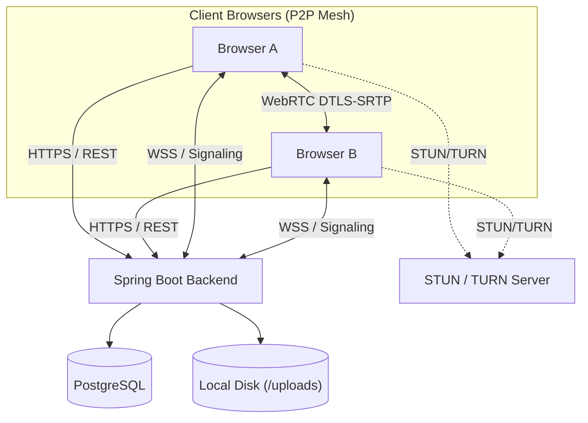

# MeetApp — Real-Time Video Conferencing & Collaboration

[](https://www.oracle.com/java/technologies/javase/jdk17-archive-downloads.html)
[](https://spring.io/projects/spring-boot)
[](https://webrtc.org/)
[](https://www.postgresql.org/)
[](LICENSE)

MeetApp is a lightweight, browser-native video conferencing platform featuring WebRTC mesh calling, screen sharing, canvas whiteboard sync, file sharing, and chat.

**Live Demo:** [PLACEHOLDER: Live Demo URL]  
**Video Walkthrough:** [PLACEHOLDER: Demo Video URL]

---

## Screenshots
| Screen | Preview Placeholder |
| :--- | :--- |
| **Login & Dashboard** | [PLACEHOLDER: Screenshot - Login & Dashboard] |
| **Pre-Join & Room** | [PLACEHOLDER: Screenshot - Pre-Join Hardware Preview] |
| **Video Grid & Screen Share**| [PLACEHOLDER: Screenshot - Video Grid & Screen Share] |
| **Whiteboard & Files** | [PLACEHOLDER: Screenshot - Collaborative Whiteboard & Files] |
| **Mobile View** | [PLACEHOLDER: Screenshot - Mobile Responsive View] |

---

## Features
- **Video Calling:** Up to 5 participants in WebRTC mesh with mic/cam toggles.
- **Screen Sharing:** Desktop screen sharing with track substitution.
- **Whiteboard:** Canvas drawing with real-time sync and late-joiner catch-up.
- **File Sharing:** In-room file transfer ($\le 10$ MB) with extension validation.
- **Group Chat:** Real-time messaging with unread badges.
- **Security:** JWT authentication, BCrypt, and DTLS-SRTP media encryption.

---

## Tech Stack
| Component | Technology | Purpose |
| :--- | :--- | :--- |
| **Backend** | Java 17, Spring Boot 3.x | Enterprise application core, REST APIs, and signaling |
| **Signaling** | Spring WebSocket (JSON) | Real-time session coordination and peer discovery |
| **Media** | Browser WebRTC API | Direct peer-to-peer audio, video, and screen sharing |
| **Database** | PostgreSQL | User accounts, rooms, participant history, file metadata |
| **Migrations** | Flyway | Automated database schema management |
| **Frontend** | HTML5, CSS3, Vanilla JS | Client UI served from Spring Boot static resources |

---

## Architecture Summary
MeetApp separates application signaling from raw media streaming. The Spring Boot backend coordinates authentication and WebSocket signaling relay. Audio, video, and screen tracks stream directly peer-to-peer via WebRTC mesh. Full design: [docs/ARCHITECTURE.md](docs/ARCHITECTURE.md).



---

## How It Works
1. **Sign In:** User authenticates to obtain a signed JWT token.
2. **Create Room:** User generates a unique room code or joins an active meeting.
3. **Signaling:** Browsers connect to `/ws` and exchange WebRTC SDP offers and ICE candidates.
4. **P2P Media:** Encrypted media streams establish directly between participants.
5. **Collaborate:** Participants chat, transfer files, or draw on the whiteboard.
6. **Teardown:** On exit, peer connections close and session state is cleared.

---

## Project Structure
```
meetapp/
├── pom.xml, Dockerfile, docker-compose.yml, .env.example, .gitignore, README.md, AGENTS.md
├── docs/ (PRD, ARCHITECTURE, DATABASE, API, SECURITY, TASKS, DEPLOYMENT, TESTING, DEMO)
└── src/
    ├── main/java/com/codealpha/meetapp/ (MeetAppApplication, common, security, auth, user, room, signaling, webrtc, whiteboard, chat, file, crypto)
    ├── main/resources/ (application*.yml, db/migration/, static/)
    └── test/java/com/codealpha/meetapp/
```

---

## Getting Started

### Prerequisites
- JDK 17, Maven 3.8+, Docker, PostgreSQL instance

### 1. Configuration
```bash
cp .env.example .env
```
Key variables: `DB_URL` (`sslmode=require`), `DB_USER`, `DB_PASSWORD`, `JWT_SECRET`, `APP_ALLOWED_ORIGIN`, `UPLOAD_DIR`, `STUN_URLS`, `TURN_URL`, `TURN_USERNAME`, `TURN_CREDENTIAL`.

### 2. Run with Docker Compose
```bash
docker compose up --build
```
Access at `http://localhost:8080`.

### 3. Run with Maven
```bash
mvn clean package
java -jar target/meetapp-0.0.1-SNAPSHOT.jar
```

### 4. Testing on Mobile Devices
WebRTC camera/mic require a secure context (HTTPS). When testing from a mobile phone, expose your local port with ngrok: `ngrok http 8080`.

---

## API Overview
| Method | Endpoint | Description |
| :--- | :--- | :--- |
| `POST` | `/api/auth/register` | User registration |
| `POST` | `/api/auth/login` | Credential login & JWT issuance |
| `POST` | `/api/rooms` | Create meeting room |
| `GET` | `/api/rooms/{code}` | Verify room & capacity |
| `POST` | `/api/rooms/{code}/end` | Host ends meeting |
| `POST` | `/api/files/upload/{code}` | File upload ($\le 10$ MB) |
| `GET` | `/api/webrtc/ice-config` | Dynamic STUN/TURN config |
| `GET` | `/actuator/health` | Health check probe |

Documentation: [docs/API.md](docs/API.md). Interactive Swagger UI: `/swagger-ui.html`.

---

## Security & Privacy Notice
- **Auth & Transport:** Stateless JWT bearer tokens, BCrypt hashing, and HTTPS/WSS.
- **Media Privacy:** Direct peer-to-peer streams are encrypted with DTLS-SRTP.
- **Disclosures:** In-room chat is TLS-encrypted but stored on the server; client E2EE is not supported in v1. In mesh WebRTC, peer IP addresses are shared between participants to establish connectivity.

Details: [docs/SECURITY.md](docs/SECURITY.md).

---

## Documentation Index
| Document | Summary |
| :--- | :--- |
| [docs/PRD.md](docs/PRD.md) | Product Requirements Document: personas, FRs, and scope |
| [docs/ARCHITECTURE.md](docs/ARCHITECTURE.md) | Architecture Design: system diagrams, packages, and mesh model |
| [docs/DATABASE.md](docs/DATABASE.md) | Database schema, Flyway migrations, and indexing strategy |
| [docs/API.md](docs/API.md) | REST API and WebSocket signaling protocol specification |
| [docs/SECURITY.md](docs/SECURITY.md) | Threat modeling, encryption mapping, and security guardrails |
| [docs/TASKS.md](docs/TASKS.md) | Sequential implementation task list across Phases 0–15 |
| [docs/DEPLOYMENT.md](docs/DEPLOYMENT.md) | Cloud deployment guide for Render and Railway |
| [docs/TESTING.md](docs/TESTING.md) | Test pyramid, test matrix, and verification plan |
| [docs/DEMO.md](docs/DEMO.md) | Demo video script, walkthrough guide, and submission checklist |

---

## Troubleshooting
1. **Camera/Mic Blocked:** Grant browser permissions; Chrome requires HTTPS or `localhost`.
2. **Video Fails Across External Networks:** NAT traversal blocked; configure valid TURN credentials in `.env`.
3. **Database SSL Error:** Append `?sslmode=require` to connection URL.
4. **CORS Error:** Verify `APP_ALLOWED_ORIGIN` matches your exact client origin.
5. **Session Expired (401):** JWT valid for 24 hours; log in again to refresh.

---

## License & Author
Distributed under the MIT License. Developed for CodeAlpha Task 4 (Real-Time Communication App).

**Author:** [PLACEHOLDER: Author Name]  
**GitHub:** [PLACEHOLDER: GitHub Profile URL]  
**LinkedIn:** [PLACEHOLDER: LinkedIn Profile URL]
