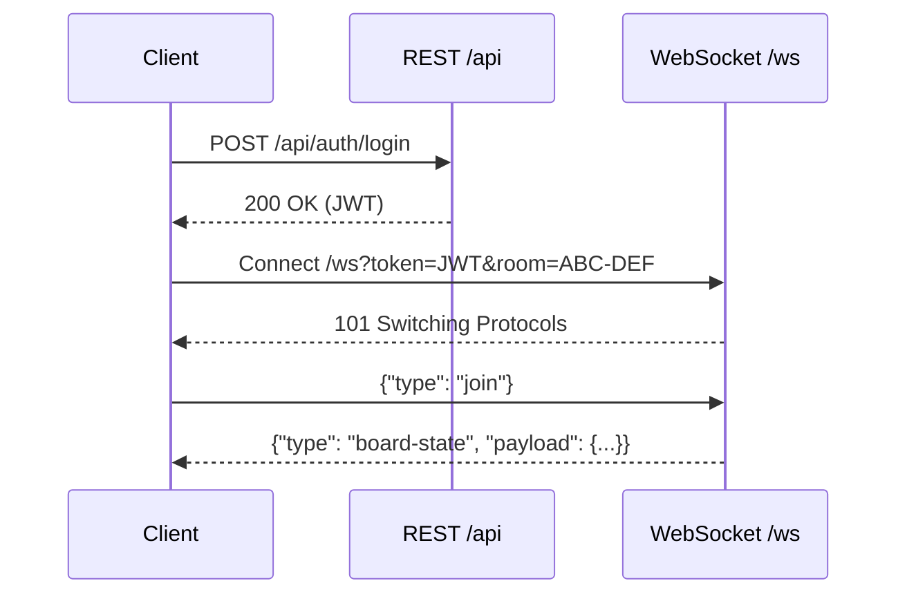
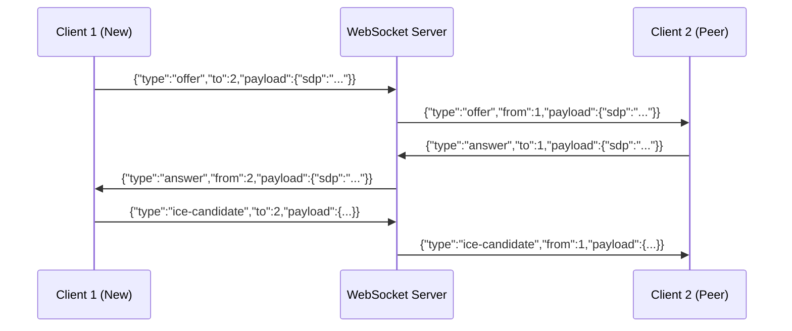
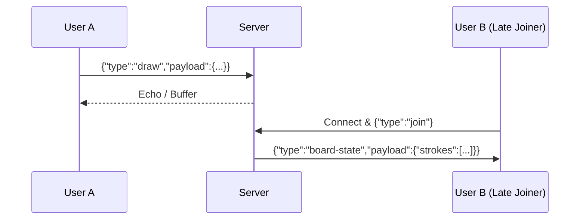

# MeetApp — API Specification (API.md)

## 1. Conventions
- **Base Paths:** REST: `/api`, WebSocket: `/ws`.
- **Payloads:** JSON (except multipart). Naming: `camelCase`. IDs: `Long` (`BIGINT`).
- **Dates:** ISO-8601 UTC (`YYYY-MM-DDTHH:mm:ssZ`).
- **Auth Header:** `Authorization: Bearer <JWT>`.

---

## 2. Standard Error Format
All REST errors return this uniform JSON body:
```json
{"timestamp":"2026-11-09T05:30:00Z","status":400,"error":"Bad Request","message":"Invalid input","path":"/api/path","fieldErrors":[{"field":"email","message":"Malformed"}]}
```
| Status | Name | Condition |
| :--- | :--- | :--- |
| `400` | Bad Request | Validation failure (malformed email, password <8 chars) |
| `401` | Unauthorized | Missing, invalid, or expired JWT |
| `403` | Forbidden | User is not a member or host of the room |
| `404` | Not Found | Room code, user, or file ID does not exist |
| `409` | Conflict | Duplicate email or room capacity full (>5) |
| `413` | Payload Too Large | File upload exceeds 10 MB limit |
| `415` | Unsupported Media | Blocked file type (`.exe`, `.bat`, etc.) |
| `429` | Too Many Requests | Rate limit exceeded |
| `500` | Server Error | Unhandled server error |

---

## 3. REST Endpoints

### 3.1 `POST /api/auth/register` (FR-1, FR-2)
- **Auth:** Anonymous.
- **Request:** `{"name": "Aarav", "email": "a@ex.com", "password": "Password1!"}` (name $\ge 2$, valid email, password $\ge 8$ with upper/digit/special).
- **Success:** `201 Created` $\to$ `{"id": 1, "name": "Aarav", "email": "a@ex.com"}`.
- **Errors:** `400` (validation), `409` (duplicate email).

### 3.2 `POST /api/auth/login` (FR-3)
- **Auth:** Anonymous.
- **Request:** `{"email": "a@ex.com", "password": "Password1!"}`.
- **Success:** `200 OK` $\to$ `{"token": "fake.jwt.token", "user": {"id": 1, "name": "Aarav", "email": "a@ex.com"}}`.
- **Errors:** `401` (bad credentials).

### 3.3 `GET /api/users/me` (FR-1)
- **Auth:** Authenticated User.
- **Success:** `200 OK` $\to$ `{"id": 1, "name": "Aarav", "email": "a@ex.com"}`.
- **Errors:** `401`.

### 3.4 `POST /api/rooms` (FR-4)
- **Auth:** Authenticated User.
- **Success:** `201 Created` $\to$ `{"roomCode": "ABC-DEF", "hostId": 1, "isActive": true, "createdAt": "2026-11-09T05:30:00Z"}`.
- **Notes:** Generates random unique 6+ char code; creator becomes host.

### 3.5 `GET /api/rooms/{code}` (FR-5, FR-7)
- **Auth:** Authenticated User.
- **Success:** `200 OK` $\to$ `{"roomCode": "ABC-DEF", "hostId": 1, "isActive": true, "participantCount": 2, "maxParticipants": 5}`.
- **Errors:** `404` (not found), `409` (room full/inactive).

### 3.6 `POST /api/rooms/{code}/end` (FR-6)
- **Auth:** Room Host.
- **Success:** `200 OK` $\to$ `{"message": "Room ABC-DEF ended"}`.
- **Errors:** `403` (not host), `404`. Side effect: Closes room WebSockets.

### 3.7 `GET /api/rooms/{code}/participants` (FR-5)
- **Auth:** Room Participant.
- **Success:** `200 OK` $\to$ `[{"userId": 1, "name": "Aarav", "joinedAt": "2026-11-09T05:30:00Z"}]`.

### 3.8 `GET /api/rooms/{code}/messages` (FR-22)
- **Auth:** Room Participant.
- **Success:** `200 OK` $\to$ `[{"id": 10, "senderId": 1, "senderName": "Aarav", "content": "Hello", "sentAt": "2026-11-09T05:32:00Z"}]`.

### 3.9 `GET /api/rooms/{code}/files` (FR-17)
- **Auth:** Room Participant.
- **Success:** `200 OK` $\to$ `[{"id": 5, "originalName": "doc.pdf", "sizeBytes": 204800, "uploaderName": "Aarav", "uploadedAt": "..."}]`.

### 3.10 `POST /api/files/upload/{code}` (FR-15, FR-16)
- **Auth:** Room Participant.
- **Request:** `multipart/form-data` with `file` ($\le 10$MB). Whitelist: PDF, DOC/X, TXT, PNG, JPG, ZIP. Block: `.exe`, `.bat`, `.sh`, `.js`.
- **Success:** `201 Created` $\to$ `{"id": 5, "originalName": "doc.pdf", "sizeBytes": 204800, "uploaderId": 1}`.
- **Errors:** `413` (>10MB), `415` (blocked type).

### 3.11 `GET /api/files/download/{id}` (FR-17)
- **Auth:** Room Participant.
- **Success:** `200 OK` binary stream with `Content-Disposition: attachment; filename="doc.pdf"`.
- **Errors:** `403`, `404`.

### 3.12 `GET /api/webrtc/ice-config` (FR-24)
- **Auth:** Authenticated User.
- **Success:** `200 OK` $\to$ `{"iceServers": [{"urls": ["stun:stun.l.google.com:19302"]}, {"urls": ["turn:turn.meetapp.com:3478"], "username": "guest", "credential": "secretpassword"}]}`.

### 3.13 `GET /actuator/health` (NFR-4)
- **Auth:** Public.
- **Success:** `200 OK` $\to$ `{"status": "UP"}`.

---

## 4. Authentication Details
- **Token:** JJWT HMAC-SHA256. Claims: `sub` (userId), `email`, `iat`, `exp` (24h).
- **Expiry:** Expired tokens return `401 Unauthorized`; client redirects to `/login.html`.
- **Logout:** Client deletes token from `localStorage`. No server session.

---

## 5. WebSocket Lifecycle
- **Endpoint:** `GET /ws?token=<JWT>&room=<code>`.
- **Handshake:** Validates JWT, room code, and capacity ($<5$).
- **Close Codes:** `1000` (Normal exit), `1008` (Policy Violation: full, duplicate tab, expired token).
- **Reconnection:** Client retries up to 3 times with exponential backoff.

---

## 6. WebSocket Message Envelope
```json
{"type": "chat", "roomCode": "ABC-DEF", "from": "1", "to": null, "payload": {}}
```
*Rule:* Server overwrites `from` with authenticated session user ID; ignores client-supplied `from`.

---

## 7. WebSocket Message Catalog

| Type | Direction | Target | Payload Example | Limits & Rules |
| :--- | :--- | :--- | :--- | :--- |
| `join` | C $\to$ S | Server | `{}` | Emitted after open |
| `peer-joined` | S $\to$ C | Room | `{"userId": 2, "name": "Priya"}` | Notifies room peers |
| `peer-left` | S $\to$ C | Room | `{"userId": 2}` | Notifies disconnect |
| `offer` | C $\to$ S $\to$ C | Peer (`to`) | `{"sdp": "v=0..."}` | WebRTC SDP offer |
| `answer` | C $\to$ S $\to$ C | Peer (`to`) | `{"sdp": "v=0..."}` | WebRTC SDP answer |
| `ice-candidate`| C $\to$ S $\to$ C | Peer (`to`) | `{"candidate": "..."}` | WebRTC ICE candidate |
| `chat` | Bidirectional | Room | `{"text": "Hello!", "timestamp": "..."}` | Max 1000 chars |
| `draw` | Bidirectional | Room | `{"tool":"pen","color":"#000","size":2,"prevX":10,"prevY":10,"x":12,"y":14}` | Max 500 points |
| `clear-board` | Bidirectional | Room | `{}` | Resets canvas |
| `board-state` | S $\to$ C | Peer | `{"strokes": [...]}` | Late-joiner sync |
| `screen-share-start` | C $\to$ S $\to$ C | Room | `{"userId": 1}` | Screen share start |
| `screen-share-stop` | C $\to$ S $\to$ C | Room | `{"userId": 1}` | Screen share stop |
| `file-shared` | S $\to$ C | Room | `{"fileId": 5, "name": "doc.pdf", "size": 2048}` | Post-upload broadcast |
| `mute-status` | Bidirectional | Room | `{"audioMuted": true, "videoMuted": false}` | Device toggles |
| `room-ended` | S $\to$ C | Room | `{"message": "Host ended meeting"}` | Disconnects peers |
| `error` | S $\to$ C | Peer | `{"code": "ROOM_FULL", "message": "Max 5"}` | Error notification |

*Limit:* Max envelope size: 64 KB.

---

## 8. Protocol Sequence Examples

### 8.1 Login & Join Room


### 8.2 WebRTC Offer / Answer / ICE Exchange


### 8.3 Whiteboard Draw & Late-Joiner Catch-Up


---

## 9. Permissions Matrix
| Action / Endpoint | Anonymous | User | Participant | Host |
| :--- | :---: | :---: | :---: | :---: |
| `POST /api/auth/*` | Yes | Yes | Yes | Yes |
| `POST /api/rooms` | No | Yes | Yes | Yes |
| `GET /api/rooms/{code}` | No | Yes | Yes | Yes |
| `POST /api/rooms/{code}/end` | No | No | No | Yes |
| `GET /api/rooms/{code}/*` | No | No | Yes | Yes |
| `POST /api/files/upload/{code}` | No | No | Yes | Yes |
| `WS /ws` (Join room) | No | Yes | Yes | Yes |
| `WS screen-share-start` | No | No | Yes | Yes |

---

## 10. Rate Limiting & Abuse Protection
- **Login:** 5 req/min per IP ($\to$ `429`).
- **File Upload:** 2 uploads/min per user ($\to$ `429`).
- **Chat:** 5 msg/sec per user (dropped if exceeded).
- **Draw:** 60 events/sec per user.

---

## 11. Versioning & Compatibility
- Version: **v1** under `/api`. Breaking changes increment to `/v2`.
- Client modules (`api.js`, `socket.js`) must strictly conform to this spec.

---

## 12. Frontend Contract Mapping
| Client Module | API / WebSocket Calls |
| :--- | :--- |
| `auth.js` | `POST /api/auth/register`, `POST /api/auth/login` |
| `dashboard.js` | `POST /api/rooms`, `GET /api/rooms/{code}`, `GET /api/users/me` |
| `socket.js` | `/ws?token=...`, connection, reconnection, heartbeat |
| `webrtc.js` | `GET /api/webrtc/ice-config`, `offer`, `answer`, `ice-candidate` |
| `room.js` | `POST /api/rooms/{code}/end`, `mute-status`, `room-ended` |
| `screenshare.js`| `screen-share-start`, `screen-share-stop` |
| `chat.js` | `GET /api/rooms/{code}/messages`, `chat` |
| `files.js` | `POST /api/files/upload/{code}`, `GET /api/files/download/{id}`, `file-shared` |
| `whiteboard.js` | `draw`, `clear-board`, `board-state` |

---

## 13. OpenAPI / Swagger Documentation
- SpringDoc OpenAPI generates docs at `/swagger-ui.html` and JSON spec at `/v3/api-docs`.
- `docs/API.md` is the design authority.

---

## 14. Postman Testing Checklist
1. `POST /api/auth/register` $\to$ Returns 201 Created.
2. `POST /api/auth/login` $\to$ Returns 200 OK with Bearer JWT.
3. `POST /api/rooms` with JWT $\to$ Returns 201 Created with `roomCode`.
4. `POST /api/files/upload/{code}` with 1MB PDF $\to$ Returns 201 Created.
5. `GET /api/files/download/{id}` $\to$ Returns 200 OK binary stream.
6. `POST /api/files/upload/{code}` with `.exe` $\to$ Returns 415 Unsupported Media.
7. `POST /api/rooms/{code}/end` $\to$ Returns 200 OK; subsequent joins fail with 409.

---

## 15. Open Questions
- *Token Refresh:* Introduce `POST /api/auth/refresh` in v2?
- *File Expiry:* Should file download URLs expire after room termination?
