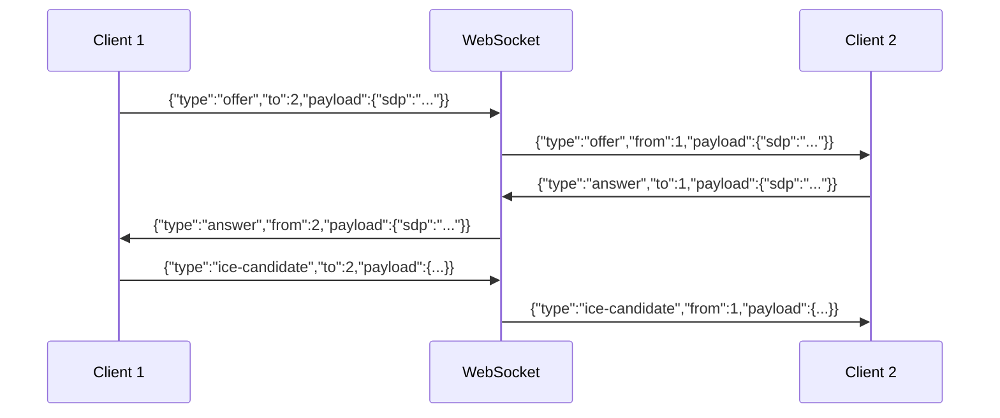

# MeetApp — API Specification (API.md)

## 1. Conventions
- **Base Paths:** REST: `/api`, WebSocket: `/ws`.
- **Payloads:** JSON (multipart for uploads). Naming: `camelCase`. IDs: `Long` (`BIGINT`).
- **Dates:** ISO-8601 UTC (`YYYY-MM-DDTHH:mm:ssZ`).
- **Auth Header:** `Authorization: Bearer <JWT>`.

## 2. Standard Error Format
```json
{"timestamp":"2026-11-09T05:30:00Z","status":400,"error":"Bad Request","message":"Invalid input","path":"/api/path"}
```
| Status | Name | Condition |
| :--- | :--- | :--- |
| `400` | Bad Request | Validation failure (malformed email, password <8 chars) |
| `401` | Unauthorized | Missing/invalid JWT or bad credentials / bad OTP |
| `403` | Forbidden | Not room host or member |
| `404` | Not Found | Room code, user, or file ID does not exist |
| `409` | Conflict | Duplicate email or room full (>5) |
| `413` | Payload Too Large | File upload exceeds 10 MB limit |
| `415` | Unsupported Media | Blocked file type (`.exe`, `.bat`, etc.) |
| `429` | Too Many Requests | Rate limit exceeded / challenge locked |
| `500` | Server Error | Unhandled server error |

## 3. REST Endpoints

### 3.1 `POST /api/auth/register` (FR-1, FR-2)
- **Auth:** Anonymous.
- **Request:** `{"name": "Aarav", "email": "a@ex.com", "password": "Password1!"}` (name $\ge 2$, valid email, password $\ge 8$ with upper/digit/special).
- **Success:** `201 Created` $\to$ `{"id": 1, "name": "Aarav", "email": "a@ex.com"}`.
- **Errors:** `400` (validation), `409` (duplicate email).

### 3.2 `POST /api/auth/login` (FR-3)
- **Auth:** Anonymous.
- **Request:** `{"email": "a@ex.com", "password": "Password1!"}`.
- **Success:** `200 OK` $\to$ `{"otpRequired": true, "challengeId": "ch_123abc", "maskedEmail": "a***@ex.com", "expiresInSeconds": 300}`.
- **Errors:** `401` (generic "Invalid email or password" to prevent user enumeration).
- **Notes:** Generates 6-digit OTP and emails user. In dev profile, OTP is logged to console.

### 3.2A `POST /api/auth/verify-otp` (FR-3A)
- **Auth:** Anonymous.
- **Request:** `{"challengeId": "ch_123abc", "otp": "123456"}` (6 numeric digits).
- **Success:** `200 OK` $\to$ `{"token": "fake.jwt.token", "user": {"id": 1, "name": "Aarav", "email": "a@ex.com"}}`.
- **Errors:** `400` (invalid format), `401` (invalid/expired OTP), `429` (locked after 5 failed attempts).

### 3.2B `POST /api/auth/resend-otp` (FR-3B)
- **Auth:** Anonymous.
- **Request:** `{"challengeId": "ch_123abc"}`.
- **Success:** `200 OK` $\to$ `{"message": "OTP resent successfully", "expiresInSeconds": 300}`.
- **Errors:** `400` (invalid challenge), `429` (cooldown active: 60s minimum wait, or max 3 resends).

### 3.3 `GET /api/users/me` (FR-1)
- **Auth:** Authenticated User (`Bearer <JWT>`).
- **Success:** `200 OK` $\to$ `{"id": 1, "name": "Aarav", "email": "a@ex.com", "createdAt": "2026-11-09T05:30:00Z"}`.
- **Errors:** `401 Unauthorized` (missing/invalid token).

### 3.3A `PATCH /api/users/me` (FR-1A)
- **Auth:** Authenticated User (`Bearer <JWT>`).
- **Request:** `{"name": "Aarav Kumar"}` (name $\ge 2$ and $\le 50$ characters, trimmed; email cannot be changed here).
- **Success:** `200 OK` $\to$ `{"id": 1, "name": "Aarav Kumar", "email": "a@ex.com", "createdAt": "2026-11-09T05:30:00Z"}`.
- **Errors:** `400 Bad Request` (name length <2 or >50, blank), `401 Unauthorized` (missing/expired token).

### 3.3B `POST /api/users/me/change-password` (FR-1A)
- **Auth:** Authenticated User (`Bearer <JWT>`).
- **Request:** `{"currentPassword": "OldPassword1!", "newPassword": "NewPassword2@"}` (same strength rules as registration: $\ge 8$ characters, at least 1 letter and 1 digit).
- **Rules:** Validates current password using BCrypt; rejects new password if identical to current password; rate limited (5 attempts per minute per user/IP).
- **Success:** `204 No Content`.
- **Errors:** `400 Bad Request` (validation failure / new password matches current password), `401 Unauthorized` (incorrect current password or missing token), `429 Too Many Requests` (rate limited).

### 3.3C `DELETE /api/users/me` (FR-1A)
- **Auth:** Authenticated User (`Bearer <JWT>`).
- **Request:** `{"password": "Password1!"}`.
- **Rules:** Verifies account password using BCrypt before deletion; rate limited (5 attempts per 15 minutes). If user is currently hosting an active room, returns `409 Conflict`. Upon confirmation, permanently deletes the user account and cascades room participation, files, messages, and OTP challenges.
- **Success:** `204 No Content`.
- **Errors:** `400 Bad Request` (missing password), `401 Unauthorized` (incorrect password or missing token), `409 Conflict` ("Cannot delete account while hosting an active meeting. Please end the meeting first."), `429 Too Many Requests`.

### 3.3D `GET /api/users/me/rooms` (FR-1B)
- **Auth:** Authenticated User (`Bearer <JWT>`).
- **Query Parameters:**
  - `from` (ISO-8601 UTC, required or defaults to start of current week): e.g. `2026-11-08T00:00:00Z`.
  - `to` (ISO-8601 UTC, required or defaults to end of current week): e.g. `2026-11-15T23:59:59Z`.
- **Behavior:** Returns rooms where the authenticated user is either the room host or an enrolled participant within the specified range. Max 50 records, ordered by `createdAt DESC`.
- **Success:** `200 OK` $\to$
  ```json
  [
    {
      "roomCode": "DEMO1001",
      "hostId": 1,
      "role": "HOST",
      "isActive": true,
      "createdAt": "2026-11-10T09:30:00Z",
      "endedAt": null,
      "participantCount": 1
    }
  ]
  ```
- **Errors:** `400 Bad Request` (malformed ISO date or `from` is after `to`), `401 Unauthorized` (missing/invalid token).

### 3.4 `POST /api/rooms` (FR-4)
- **Auth:** Authenticated User.
- **Behavior:** Generates a unique room code and creates an active room record. **Decoupled host entry:** The host is *not* inserted into `room_participants` during room creation; participant rows are created only when a user actually connects to the room session. This enables both instant meetings and pre-created shareable links ("Create a meeting link for later"). Initial `participantCount` is 0.
- **Success:** `201 Created` $\to$ `{"roomCode": "DEMO1001", "hostId": 1, "isActive": true, "participantCount": 0, "createdAt": "2026-11-09T05:30:00Z"}`.

### 3.5 `GET /api/rooms/{code}` (FR-5, FR-7)
- **Auth:** Authenticated User.
- **Success:** `200 OK` $\to$ `{"roomCode": "DEMO1001", "hostId": 1, "isActive": true, "participantCount": 2, "maxParticipants": 5}`.
- **Errors:** `404` (not found), `409` (room full/inactive).

### 3.6 `POST /api/rooms/{code}/end` (FR-6)
- **Auth:** Room Host.
- **Success:** `200 OK` $\to$ `{"message": "Room DEMO1001 ended"}`. Errors: `403` (not host), `404`.

### 3.7 `GET /api/rooms/{code}/participants` (FR-5)
- **Auth:** Room Participant.
- **Success:** `200 OK` $\to$ `[{"userId": 1, "name": "Aarav", "joinedAt": "2026-11-09T05:30:00Z"}]`.

### 3.8 `GET /api/rooms/{code}/messages` (FR-22)
- **Auth:** Authenticated User (`Bearer <JWT>`). Caller must be an active or past participant of room `{code}`. Outsiders receive `403 Forbidden`. Unknown room receives `404 Not Found`.
- **Query Parameters:**
  - `limit`: Optional integer, default `50`, maximum `100`. Defines the page size.
  - `before`: Optional integer/long message ID cursor. When specified, returns messages strictly with `id < before`.
- **Behavior:**
  - Retrieves messages matching `room_id = :roomId` and `(:before IS NULL OR id < :before)` ordered by `id DESC LIMIT :limit`.
  - Reverses the order in memory before serializing so the client receives them in chronological **oldest-first** order.
  - Decrypts ciphertext (AES-256-GCM) transparently before returning plaintext to authorized participants.
  - Never exposes user email addresses, password hashes, or internal database metadata.
- **Success Response:** `200 OK`
  ```json
  [
    {
      "id": 140,
      "senderId": 1,
      "senderName": "Aarav Patel",
      "text": "Hey everyone, can you hear me clearly?",
      "sentAt": "2026-11-11T10:14:00Z"
    },
    {
      "id": 141,
      "senderId": 2,
      "senderName": "Priya Sharma",
      "text": "Yes Aarav, loud and clear!",
      "sentAt": "2026-11-11T10:14:15Z"
    }
  ]
  ```
- **Errors:**
  - `401 Unauthorized`: Missing, invalid, or expired JWT.
  - `403 Forbidden`: Authenticated user is not an active or recorded participant of this room.
  - `404 Not Found`: Room code does not exist.

### 3.9 `GET /api/rooms/{code}/files` (FR-17)
- **Auth:** Room Participant (`Bearer <JWT>`). Caller must be an active or recorded participant in the room.
- **Query Parameters:**
  - `limit`: Integer (optional, 1 to 100, default `50`). Maximum number of file items to return.
  - `before`: Long (optional, positive integer). Cursor representing the `id` of a file; returns files uploaded prior to this ID (`id < before`).
- **Success:** `200 OK` $\to$
  ```json
  {
    "files": [
      {
        "id": 42,
        "originalName": "sprint-backlog.pdf",
        "sizeBytes": 1048576,
        "contentType": "application/pdf",
        "uploaderId": 1,
        "uploaderName": "Aarav Patel",
        "uploadedAt": "2026-11-12T08:30:00Z"
      },
      {
        "id": 41,
        "originalName": "architecture-diagram.png",
        "sizeBytes": 524288,
        "contentType": "image/png",
        "uploaderId": 2,
        "uploaderName": "Priya Sharma",
        "uploadedAt": "2026-11-12T08:25:00Z"
      }
    ],
    "hasMore": false
  }
  ```
- **Ordering:** Strictly ordered newest-first (`uploaded_at DESC, id DESC`).
- **Errors:**
  - `400 Bad Request`: Invalid `limit` (< 1 or > 100) or negative/zero `before` cursor.
  - `401 Unauthorized`: Missing or invalid JWT.
  - `403 Forbidden`: Authenticated user is not a participant in this room.
  - `404 Not Found`: Room code does not exist.

### 3.10 `POST /api/files/upload/{code}` (FR-15, FR-16)
- **Auth:** Room Participant (`Bearer <JWT>`). Caller must be an active participant in this room.
- **Request:** `multipart/form-data` with parameter `file` ($\le 10$ MB).
- **Validation & Server Rules:**
  - Single file upload per request.
  - Size limit: Enforced at the HTTP filter and streaming layer prior to in-memory buffering. Exceeding 10 MB returns `413 Payload Too Large`.
  - Extension Allow-list: Images (`.png`, `.jpg`, `.jpeg`, `.gif`, `.webp`) and Documents (`.pdf`, `.txt`, `.csv`, `.docx`, `.xlsx`, `.pptx`). Archives such as `.zip` are strictly blocked.
  - Block-list: Executables, archives, scripts, and markup (`.exe`, `.bat`, `.cmd`, `.sh`, `.ps1`, `.js`, `.mjs`, `.html`, `.htm`, `.svg`, `.jar`, `.msi`, `.dll`, `.apk`, `.zip`, `.tar`, `.gz`, `.7z`). Rejects any double extensions containing blocked extensions (e.g., `image.png.exe`, `notes.pdf.sh`).
  - Magic-byte verification: Validates file headers for binary signatures (PNG, JPEG, GIF, WebP, PDF). For `.docx`, `.xlsx`, and `.pptx`, verifies standard ZIP container signature (`PK\x03\x04`). Rejects any `.zip` filename regardless of signature. Never trusts client-supplied `Content-Type`.
  - Room Quota: Maximum 20 files and 50 MB total storage per room. Exceeding quota returns `413 Payload Too Large`.
  - Stored Name: Completely random UUID filename on disk (`uuid.ext`); original user filename is never used on the filesystem.
  - Display Name Sanitization: Strips directory traversal (`../`, `..\`), strips control characters, normalizes Unicode (NFC), and caps at 100 characters.
  - Persistence & Notification Rule: File binary is written atomically to storage, metadata is committed to the database, and THEN the server broadcasts `file-shared` to the room via WebSocket. If storage write fails, nothing is saved to DB; if DB save fails, the stored file is deleted immediately.
- **Success:** `201 Created` $\to$
  ```json
  {
    "id": 42,
    "originalName": "sprint-backlog.pdf",
    "sizeBytes": 1048576,
    "contentType": "application/pdf",
    "uploaderId": 1,
    "uploaderName": "Aarav Patel",
    "uploadedAt": "2026-11-12T08:30:00Z"
  }
  ```
- **Errors:**
  - `400 Bad Request`: Empty file (`size == 0`), missing file part, or malformed multipart data.
  - `401 Unauthorized`: Missing or invalid JWT.
  - `403 Forbidden`: Authenticated user is not an active participant in this room.
  - `404 Not Found`: Room code does not exist.
  - `409 Conflict`: Room is inactive or ended.
  - `413 Payload Too Large`: File exceeds 10 MB limit or room quota (20 files / 50 MB) would be exceeded.
  - `415 Unsupported Media Type`: Blocked extension, unknown extension, double extension, or magic-byte signature mismatch.
  - `429 Too Many Requests`: Upload rate limit exceeded (burst 5, max 10 uploads/minute per user).
  - `500 Internal Server Error`: Disk storage failure (sanitized generic error; server paths are never leaked).

### 3.11 `GET /api/files/download/{id}` (FR-17)
- **Auth:** Room Participant (`Bearer <JWT>`).
- **Authorization Rule:** Caller must be an active or recorded participant of the specific meeting room associated with the file. Non-participants receive generic `404 Not Found` (or `403 Forbidden`) to eliminate file ID enumeration.
- **Response:** Binary file stream.
- **Security Headers Enforced:**
  - `Content-Disposition: attachment; filename="<sanitized>"; filename*=UTF-8''<encoded>` (forces file download; prevents inline browser execution).
  - `X-Content-Type-Options: nosniff` (prevents browser MIME sniffing).
  - `Cache-Control: private, no-cache, no-store, must-revalidate` (prevents caching of private meeting files on shared proxies/caches).
  - `Content-Type`: Safe whitelist MIME type, falling back to `application/octet-stream` for all unknown or complex types.
- **Errors:**
  - `401 Unauthorized`: Missing or invalid JWT.
  - `403 Forbidden`: Authenticated user is not permitted to access this room's files.
  - `404 Not Found`: File ID does not exist or user is an outsider.
  - `500 Internal Server Error`: Stored file missing from disk or decryption error.

### 3.11A `DELETE /api/files/{id}` (FR-17)
- **Auth:** File Uploader or Room Host (`Bearer <JWT>`).
- **Authorization Rule:** Only the original uploader (`uploader_id == user.id`) OR the meeting room host (`room.host_id == user.id`) is authorized to delete a file. Other room participants receive `403 Forbidden`.
- **Action:** Permanently deletes the file binary from disk storage, deletes the `FileMeta` database record, and broadcasts `file-deleted` over WebSocket to all active room participants.
- **Success:** `204 No Content`.
- **Errors:**
  - `401 Unauthorized`: Missing or invalid JWT.
  - `403 Forbidden`: User is neither the uploader nor the room host.
  - `404 Not Found`: File ID does not exist.

### 3.12 `GET /api/webrtc/ice-config` (FR-24)
- **Auth:** Authenticated User (`Bearer <JWT>`).
- **Headers:** `Cache-Control: no-store, no-cache, must-revalidate` (response must never be cached by browser or proxies).
- **Rate Limit:** 10 requests per minute per user (`429 Too Many Requests`).
- **Success:** `200 OK` $\to$
  ```json
  {
    "iceServers": [
      {
        "urls": ["stun:stun.l.google.com:19302"]
      },
      {
        "urls": [
          "turn:turn.meetapp.com:3478?transport=udp",
          "turn:turn.meetapp.com:3478?transport=tcp"
        ],
        "username": "relay_user",
        "credential": "relay_password"
      }
    ]
  }
  ```
- **Rules:**
  - STUN URLs are always returned from `app.webrtc.stun-urls`.
  - TURN entry is included only if `TURN_URL`, `TURN_USERNAME`, and `TURN_CREDENTIAL` (or time-limited dynamic credentials) are configured.
  - Never logs credentials in logs; `AppProperties.toString()` masks the credential.
- **Errors:** `401 Unauthorized` (missing/invalid token), `429 Too Many Requests` (rate limit exceeded).

### 3.13 `GET /actuator/health` (NFR-4)
- **Auth:** Public.
- **Success:** `200 OK` $\to$ `{"status": "UP"}`.

## 4. Authentication Details
- **Token:** JJWT HMAC-SHA256. Claims: `sub` (userId), `email`, `iat`, `exp` (24h).
- **Expiry:** Expired tokens return `401 Unauthorized`; client redirects to `/login.html`.
- **Logout:** Client deletes token from `localStorage`. No server session.

## 5. WebSocket Signaling Lifecycle (Phase 6 Foundation)
- **Endpoint:** `GET /ws?token=<JWT>&room=<code>` (or `GET /ws?ticket=<TICKET>&room=<code>` if single-use ticket mechanism is enabled).
- **Handshake Verification Steps:**
  1. **Origin Verification:** Handshake interceptor strictly validates the `Origin` header against `APP_ALLOWED_ORIGIN`. Wildcards are rejected.
  2. **Authentication:** Extracts and validates the token/ticket. Extracts `userId` and user identity.
  3. **Room Existence & State:** Checks room code exists in DB and `is_active = TRUE`.
  4. **Active Participant Check:** The connecting user must already have an active participant record (`room_participants` row with `left_at IS NULL`) established beforehand via the REST endpoint `POST /api/rooms/{code}/join`. Unregistered users or users not marked as active participants are rejected with HTTP 403 Forbidden / WebSocket closure code `4003`.
  5. **Capacity Check:** Ensures room active participant count does not exceed 5 (`4009`).
  6. **Session Session Attachment:** Puts `userId`, `roomCode`, and display `name` into `WebSocketSession` attributes.
- **Session Replacement:** A user may only have one active WebSocket session per room. When a second connection for the same `userId` in the same room opens, the server registers the new session and immediately closes the older session with close code `4000` ("Replaced by newer session").
- **Close Codes & Human-Readable Reasons:**
  | Close Code | Constant Name | Condition / Reason |
  | :--- | :--- | :--- |
  | `1000` | Normal Closure | Normal exit (caller invoked leave or closed connection cleanly). |
  | `4000` | Session Replaced | Replaced by a newer session for the same user in another tab/window. |
  | `4001` | Unauthorized | Missing, invalid, or expired authentication token / ticket. |
  | `4003` | Forbidden | User is not an active participant of this room (must join via REST first). |
  | `4009` | Room Full | Room capacity reached maximum limit (>5 active members). |
  | `4010` | Room Ended | Meeting room was terminated by host. |
  | `1009` / `4013` | Message Too Large | Inbound message payload exceeded maximum permitted size. |
  | `4029` | Rate Limited | Message throughput exceeded session rate limits. |
  | `1011` | Server Error | Internal server error encountered during session handling. |

- **Signaling Limits & Timeouts:**
  - **Maximum Message Size:** 16 KB (16,384 bytes) for signaling text frames (SDP $\le 16$ KB, ICE candidate $\le 2$ KB, non-media $\le 4$ KB).
  - **Session Rate Limits (Token Bucket):**
    - Media Relay (`offer`, `answer`, `ice-candidate`): steady rate of 30 messages/second, burst capacity of 100 per session (accommodates initial candidate storm when connecting to multiple mesh peers).
    - Non-Media Control Messages (`ping`, `mute-status`, `join`): steady rate of 10 messages/second, burst capacity of 20 per session.
  - **Heartbeat & Idle Timeout:** Client sends `ping` every 25 seconds. If no message or heartbeat is received from a client for 60 seconds, the server terminates the session.
  - **Reconnection:** Client retries up to 5 times with exponential backoff and random jitter. Reconnection stops immediately upon non-retryable close codes (`4001`, `4003`, `4009`, `4010`, `4000`).

## 6. WebSocket Message Envelope
```json
{
  "type": "join",
  "roomCode": "DEMO1001",
  "from": 1,
  "to": null,
  "payload": {}
}
```
*Envelope Rules:*
- `type`: String (required). Must match a recognized enum type.
- `roomCode`: String (required, 8 uppercase alphanumeric characters). Must match the session room code.
- `from`: Long (optional in request). The server **always sets / overwrites** `from` with the authenticated session `userId` and discards any client-supplied sender ID to prevent identity spoofing.
- `to`: Long (optional). Target peer `userId` for direct messages. `null` indicates room broadcast.
- `payload`: Object/Node (required). Message-specific data payload.

## 7. WebSocket Message Catalog

### 7.1 Implemented Signaling & Media Relays (Phase 6 & 7)
| Type | Direction | Target | Payload Example | Description & Rules |
| :--- | :--- | :--- | :--- | :--- |
| `join` | C $\to$ S | Server | `{}` | Emitted immediately after WebSocket opens to complete signaling attachment. |
| `join` (ack) | S $\to$ C | Caller | `{"userId": 1, "roomCode": "DEMO1001", "peers": [{"userId": 2, "name": "Priya", "audioMuted": false, "videoMuted": false}], "presenter": {"userId": 2, "streamId": "stream-xyz"} }` | Server confirmation returning the caller's verified ID, active peers with mute states, and currently active screen presenter info (or `null` if nobody is sharing). |
| `peer-joined` | S $\to$ C | Room | `{"userId": 1, "name": "Aarav"}` | Broadcast to all other room peers when a participant completes join. |
| `peer-left` | S $\to$ C | Room | `{"userId": 1, "reason": "LEFT"}` | Broadcast to all remaining peers when a participant disconnects or leaves. Clears active presenter state if the leaving peer was presenting. |
| `ping` | C $\to$ S | Server | `{}` | Heartbeat probe sent periodically by client to keep socket alive. |
| `pong` | S $\to$ C | Caller | `{}` | Immediate server acknowledgement to client `ping`. |
| `offer` | C $\to$ S $\to$ C | Peer (`to` required) | `{"sdp": "v=0...", "type": "offer"}` | WebRTC SDP offer unicast relay. Max payload: 16 KB. Server validates `to` is in same room, sets `from`, and forwards strictly to `to`. Used for both webcam and screen track renegotiation. |
| `answer` | C $\to$ S $\to$ C | Peer (`to` required) | `{"sdp": "v=0...", "type": "answer"}` | WebRTC SDP answer unicast relay. Max payload: 16 KB. Forwarded strictly to `to`. |
| `ice-candidate`| C $\to$ S $\to$ C | Peer (`to` required) | `{"candidate": "candidate:...", "sdpMid": "0", "sdpMLineIndex": 0, "usernameFragment": "..."}` | WebRTC ICE candidate unicast relay. Max payload: 2 KB. Forwarded strictly to `to`. |
| `mute-status` | C $\to$ S $\to$ C | Room (`to` null) | `{"audioMuted": true, "videoMuted": false}` | Broadcast to room peers (sender excluded). Server stores state in `RoomSessionRegistry` to seed late joiners (evicted on session disconnect/replacement). |
| `screen-share-start` | C $\to$ S $\to$ C | Room (`to` null) | `{"streamId": "screen-stream-123", "label": "Window"}` | Announces screen sharing started. Enforces strict single-presenter rule. Recorded in `RoomSessionRegistry` and broadcast to peers. Rate limited: 10/min. |
| `screen-share-stop` | C $\to$ S $\to$ C | Room (`to` null) | `{"reason": "USER_STOPPED"}` | Announces screen sharing stopped. Valid reasons: client (`USER_STOPPED`, `TRACK_ENDED`), host (`HOST_STOPPED`), server (`DISCONNECTED`, `LEFT`, `ROOM_ENDED`). Clears presenter in registry and broadcasts to peers (and to presenter on host stop). |
| `room-ended` | S $\to$ C | Room | `{"message": "Host ended the meeting"}` | Dispatched to all active participants when host terminates room via REST. Sockets closed with code `4010`. |
| `error` | S $\to$ C | Caller | `{"code": "ALREADY_PRESENTING", "message": "Another participant is already sharing their screen"}` | Unicast error alert returned on validation errors, active presenter collision, unauthorized stops, or throttled actions. |

*Server Relay Principles:*
- **Zero Media Handling:** The server relays signaling envelopes exclusively; it never captures, decodes, inspects, or proxies raw RTP/SRTP media streams.
- **Payload Inspection Limit:** The server validates only that JSON frames adhere to expected DTO structures and size caps (SDP $\le 16$ KB, ICE candidate $\le 2$ KB); SDP contents are opaque strings to the server.
- **Room Boundary Enforcement:** Signaling relays (`offer`, `answer`, `ice-candidate`) are rejected with an error if the target peer (`to`) is not an active participant in the exact same `roomCode` as the sender. Self-directed messages (`from == to`) are dropped.

### 7.2 Screen Sharing Signaling Specifications (Phase 8)

#### 7.2.1 `screen-share-start`
- **Direction:** Client $\to$ Server $\to$ Room Broadcast (`to: null`, sender excluded from broadcast).
- **Inbound Payload:**
  ```json
  {
    "type": "screen-share-start",
    "roomCode": "DEMO1001",
    "payload": {
      "streamId": "screen-stream-12345",
      "label": "Window"
    }
  }
  ```
- **Outbound Broadcast Payload:**
  ```json
  {
    "type": "screen-share-start",
    "roomCode": "DEMO1001",
    "from": 1,
    "to": null,
    "payload": {
      "userId": 1,
      "streamId": "screen-stream-12345",
      "label": "Window"
    }
  }
  ```
- **Validation & Server Rules:**
  1. `streamId` is required (string 1–64 chars). `label` is optional (string $\le 64$ chars).
  2. **Strict Single Presenter Rule:** Only ONE active screen presenter is permitted per room at any given time.
  3. If another participant is already presenting, the server rejects the request immediately by sending an `error` envelope to the caller:
     ```json
     {
       "type": "error",
       "roomCode": "DEMO1001",
       "from": 0,
       "payload": {
         "code": "ALREADY_PRESENTING",
         "message": "Another participant is already sharing their screen"
       }
     }
     ```
  4. The server atomically updates `RoomSessionRegistry` with the active presenter state (`presenterUserId`, `streamId`, `startedAt`).
  5. The server sets `from` to the verified session `userId` and broadcasts the envelope to all other active sessions in the room.

#### 7.2.2 `screen-share-stop`
- **Direction:** Client $\to$ Server $\to$ Room Broadcast (`to: null`).
- **Inbound Payload:**
  ```json
  {
    "type": "screen-share-stop",
    "roomCode": "DEMO1001",
    "payload": {
      "reason": "USER_STOPPED"
    }
  }
  ```
- **Outbound Broadcast Payload:**
  ```json
  {
    "type": "screen-share-stop",
    "roomCode": "DEMO1001",
    "from": 1,
    "to": null,
    "payload": {
      "userId": 1,
      "reason": "USER_STOPPED"
    }
  }
  ```
- **Standardized Reason Taxonomy:**
  | Reason | Allowed Sender | Condition |
  | :--- | :--- | :--- |
  | `USER_STOPPED` | Presenter Client | Presenter clicked "Stop sharing" inside the MeetApp controls. |
  | `TRACK_ENDED` | Presenter Client | Presenter stopped sharing via the browser's native floating share bar. |
  | `HOST_STOPPED` | Room Host Client / Server | Room host clicked "Stop share" on the presenter's tile or drawer. |
  | `LEFT` | Server Alone | Presenter invoked REST leave or closed tab cleanly while presenting. |
  | `DISCONNECTED`| Server Alone | Presenter socket connection dropped without clean closure. |
  | `ROOM_ENDED` | Server Alone | Host terminated the room (`POST /rooms/{code}/end`). |

- **Authorization & Rules:**
  1. **Presenter Self-Stop:** The currently active presenter may stop their own screen share at any time using reason `USER_STOPPED` or `TRACK_ENDED`.
  2. **Host Authority Stop:** The room host (creator of the meeting) is authorized to stop any participant's screen share using `reason: "HOST_STOPPED"`.
  3. **Presenter Notification on Host Stop:** On a host stop, the server dispatches `screen-share-stop` with `reason: "HOST_STOPPED"` to the **presenter's own session as well**, directing the presenter's client to halt local screen track capture immediately.
  4. **Unauthorized Stop:** If a non-host participant attempts to send `screen-share-stop` while another user is presenting, the server rejects the message with error code `FORBIDDEN` (`"Only the presenter or the meeting host can stop screen sharing"`). Clients sending unrecognized reason strings receive `INVALID_PAYLOAD`.
  5. The server clears the presenter state in `RoomSessionRegistry` and broadcasts `screen-share-stop` to room members. Other clients must ignore any screen stream once presenter state is cleared.
  6. **Rate Limiting:** Capped at 10 screen-share control events per minute per session. User cancellations in the native browser picker never hit the server.

#### 7.2.3 Late Joiner Discovery & Session Lifecycle Cleanup
- **Join Confirmation Seeding:** The server includes the active presenter in the `join` acknowledgment (`JoinAckPayload`):
  ```json
  {
    "userId": 3,
    "roomCode": "DEMO1001",
    "peers": [...],
    "presenter": {
      "userId": 1,
      "streamId": "screen-stream-12345"
    }
  }
  ```
  If no participant is currently sharing, `presenter` is `null`. Late-joining peers immediately know who is presenting and can attach the incoming video track with matching `streamId` to the presenter tile.
- **Presenter Reconnection:** If the presenter's socket reconnects, the presenter's client must stop sharing and the server clears the presenter state.
- **Automatic Server Cleanup on Exit Paths:**
  The server clears the active presenter state and automatically broadcasts `screen-share-stop` to room peers whenever:
  1. The presenter sends an explicit `screen-share-stop` (`USER_STOPPED`, `TRACK_ENDED`).
  2. The presenter leaves the room (`LEFT`).
  3. The presenter drops connection or socket closes without reconnecting (`DISCONNECTED`).
  4. The presenter's session is replaced by a newer session in another tab (code `4000`, `DISCONNECTED`).
  5. The meeting room is terminated by the host (`room-ended`, code `4010`, `ROOM_ENDED`).

### 7.3 In-Room Group Chat Signaling (`chat`) (FR-22, FR-23)

#### 7.3.1 Inbound Chat Message (Client $\to$ Server)
- **Direction:** Client $\to$ Server.
- **Inbound Envelope:**
  ```json
  {
    "type": "chat",
    "roomCode": "DEMO1001",
    "payload": {
      "text": "Can someone share the presentation deck?",
      "clientId": "c-9f8a-4b12-88ef"
    }
  }
  ```
- **Validation & Server Invariants:**
  1. `text`: String, trimmed, length between 1 and 1000 characters. Rejects empty or whitespace-only messages.
  2. No control characters except newline (`\n`, `\r\n`). Characters matching regex `[\u0000-\u0008\u000B\u000C\u000E-\u001F\u007F-\u009F]` are rejected.
  3. Maximum 20 lines (split by newline `\n`).
  4. `clientId`: String, 1 to 64 characters, generated by the client to correlate the server broadcast echo with its local optimistic pending message.
  5. The server strictly sets `id`, `from`, `name`, and `sentAt`. Any client-provided values for these fields are ignored and overwritten.
  6. **Persistence Rule (Save Before Broadcast):** The server encrypts and saves the message to the database table `messages` **before** broadcasting. If database persistence fails, an error envelope (`MESSAGE_SAVE_FAILED`) is sent to the sender session only, and no broadcast occurs. This guarantees that live delivery and persisted history never disagree.

#### 7.3.2 Outbound Broadcast Message (Server $\to$ All Room Participants)
- **Direction:** Server $\to$ Room Broadcast (`to: null`).
- **Recipient:** Dispatched to **EVERY active participant in the room, INCLUDING the sender**.
- **Broadcast Envelope:**
  ```json
  {
    "type": "chat",
    "roomCode": "DEMO1001",
    "from": 1,
    "to": null,
    "payload": {
      "id": 142,
      "from": 1,
      "name": "Aarav Patel",
      "text": "Can someone share the presentation deck?",
      "sentAt": "2026-11-11T10:15:30Z",
      "clientId": "c-9f8a-4b12-88ef"
    }
  }
  ```
- **Echo & Correlation:**
  - The sender matches the inbound broadcast against its local pending queue using `clientId`. Once matched, the pending message transitions to "sent" state and its permanent server-assigned `id` and `sentAt` are saved.
  - Remote peers simply append the message to their chat view.

#### 7.3.3 Chat Error Conditions
| Code | HTTP / WS Context | Condition |
| :--- | :--- | :--- |
| `INVALID_PAYLOAD` | WS Error Envelope | Empty text, length > 1000 chars, > 20 lines, or illegal control characters. |
| `FORBIDDEN` | WS Error Envelope | User is not an active participant in the room. |
| `RATE_LIMIT_EXCEEDED` | WS Error Envelope | Sender exceeded the chat rate limit threshold. |
| `MESSAGE_SAVE_FAILED` | WS Error Envelope | Database write failed; broadcast aborted. |
| `4029` | WS Socket Close | Repeated and abusive chat rate limit violations. |

#### 7.3.4 Rate Limiting Specification
- **Token Bucket Limiter:**
  - Bucket capacity (burst): 5 messages.
  - Refill rate (steady): 1 message per second per session.
  - Hard cap: Maximum 30 messages per minute per session.
- Exceeding the burst or steady rate returns an `error` envelope with code `RATE_LIMIT_EXCEEDED`. Repeated flooding closes the WebSocket with status code `4029` ("Chat rate limit exceeded").

### 7.4 In-Room File Sharing Signaling (`file-shared`, `file-deleted`) (FR-15, FR-17)

#### 7.4.1 `file-shared` Notification (Server $\to$ Room Broadcast)
- **Direction:** Server $\to$ Room Broadcast (`to: null`).
- **Trigger:** Dispatched automatically by the backend server **strictly AFTER** a file upload completes successfully, the binary is stored, and the database record is committed.
- **Client Invariant:** The client **NEVER** sends `file-shared` directly over the WebSocket. Any client-sent `file-shared` envelope is rejected by the server with `FORBIDDEN`.
- **Broadcast Envelope:**
  ```json
  {
    "type": "file-shared",
    "roomCode": "DEMO1001",
    "from": 1,
    "to": null,
    "payload": {
      "fileId": 42,
      "originalName": "sprint-backlog.pdf",
      "sizeBytes": 1048576,
      "uploaderId": 1,
      "uploaderName": "Aarav Patel",
      "uploadedAt": "2026-11-12T08:30:00Z"
    }
  }
  ```
- **Client Reaction:**
  - In-room clients receive this notification and prepend the new file entry to their Files list.
  - If the Files panel is closed or unfocused, the unread Files badge counter increments (capped at `99+`) and an accessible announcement is made (`"Aarav Patel shared sprint-backlog.pdf"`).

#### 7.4.2 `file-deleted` Notification (Server $\to$ Room Broadcast)
- **Direction:** Server $\to$ Room Broadcast (`to: null`).
- **Trigger:** Dispatched automatically by the backend server **strictly AFTER** a file is successfully deleted via `DELETE /api/files/{id}`.
- **Broadcast Envelope:**
  ```json
  {
    "type": "file-deleted",
    "roomCode": "DEMO1001",
    "from": 1,
    "to": null,
    "payload": {
      "fileId": 42
    }
  }
  ```
- **Client Reaction:** In-room clients remove the file item corresponding to `fileId` from their Files list in real time.

### 7.5 Collaborative Whiteboard Events (FR-18, FR-19, FR-20, FR-21)

The collaborative whiteboard enables real-time vector drawing, geometric shapes, erasing, stroke undo, and host board clearing over Spring WebSocket. Drawing coordinates are normalized to `[0.0, 1.0]` of a fixed `16:9` canvas area letterboxed uniformly on all client screens regardless of display dimensions. Board state is maintained strictly in server memory per room (never persisted in PostgreSQL) and synced to late joiners via chunked `board-state` messages.

#### 7.5.1 Board Coordinate & Geometric Normalization
- **Coordinate Space:** Normalized floating-point space where `x = 0.0` (left) to `1.0` (right), and `y = 0.0` (top) to `1.0` (bottom).
- **Aspect Ratio:** Fixed `16:9` (width / height = 1.7778). Clients render with CSS/canvas letterboxing (`object-fit: contain` behavior) maintaining proportional geometry across mobile, tablet, and ultra-wide screens.
- **Stroke Width:** Integer or floating-point in range `1 .. 32` relative to board coordinate units (client scales width proportionally to active rendered canvas width).
- **Tool Whitelist:** `pen`, `eraser`, `line`, `rect`, `ellipse`.
- **Color Format:** 6-character hexadecimal color string matching regex `^#[0-9a-fA-F]{6}$` (e.g. `#1F6F5B`). For `eraser`, color is ignored during rendering but must pass validation.

#### 7.5.2 `draw` Message (Client $\to$ Server $\to$ Room Broadcast)
- **Direction:** Client $\to$ Server, then Server $\to$ Room Broadcast (sender excluded).
- **Batching Semantics:** High-frequency tools (`pen`, `eraser`) stream points in batches under a single `strokeId` every ~40ms until the pointer is released (`final: true`). Geometric shapes (`line`, `rect`, `ellipse`) send exactly 2 points (`[start, end]`) in a single message with `final: true`.
- **Client Inbound Payload:**
  ```json
  {
    "type": "draw",
    "roomCode": "DEMO1001",
    "payload": {
      "strokeId": "s_7a1b2c3d4e",
      "tool": "pen",
      "color": "#1F6F5B",
      "width": 4,
      "points": [
        [0.1250, 0.4500],
        [0.1280, 0.4550],
        [0.1320, 0.4610]
      ],
      "final": false
    }
  }
  ```
- **Server Processing & Validation:**
  1. Authenticates caller session and verifies active room membership in `RoomSessionRegistry`.
  2. Strips any client-provided `from` field and binds the authenticated session `userId`.
  3. Enforces token bucket rate limiter (20 messages/sec with burst allowance of 40). Exceeding sends `RATE_LIMITED` error; repeated flooding disconnects with code `1008`.
  4. Validates payload constraints:
     - `strokeId`: non-blank, alphanumeric, hyphens or underscores, 1 to 64 characters.
     - `tool`: must be one of `pen`, `eraser`, `line`, `rect`, `ellipse`.
     - `color`: must match `^#[0-9a-fA-F]{6}$`.
     - `width`: number in range `1.0 .. 32.0`.
     - `points`: array of `[x, y]` coordinate pairs (1 to 50 points per batch).
     - Each coordinate must be a finite number, non-NaN, non-Infinity, with `0.0 <= x <= 1.0` and `0.0 <= y <= 1.0`.
     - Shapes (`line`, `rect`, `ellipse`) must have exactly 2 points and `final: true`.
  5. Enforces stroke ownership: If `strokeId` already exists on the room board, its recorded `userId` must match the sender's `userId`. If another user owns that `strokeId`, reject with error code `STROKE_CONFLICT`.
  6. Enforces memory caps:
     - Max strokes per room: **1,000**.
     - Max points per individual stroke: **500**.
     - Max total points across board: **25,000**.
     - If adding this segment would exceed room stroke or point limits, reject with error code `BOARD_FULL` (`"Whiteboard capacity reached for this room"`) and leave existing board state intact.
  7. Appends segment points to the in-memory stroke list in `WhiteboardService`.
  8. Relays broadcast envelope to all room participants except sender (`to: null`).
- **Server Broadcast Envelope:**
  ```json
  {
    "type": "draw",
    "roomCode": "DEMO1001",
    "from": 1,
    "to": null,
    "payload": {
      "strokeId": "s_7a1b2c3d4e",
      "tool": "pen",
      "color": "#1F6F5B",
      "width": 4,
      "points": [
        [0.1250, 0.4500],
        [0.1280, 0.4550],
        [0.1320, 0.4610]
      ],
      "final": false
    }
  }
  ```

#### 7.5.3 `stroke-undo` Message (Client $\to$ Server $\to$ Room Broadcast)
- **Direction:** Client $\to$ Server, then Server $\to$ Room Broadcast (to all participants).
- **Ownership Rule:** A participant may undo **only their own strokes** in reverse chronological order. Meeting hosts cannot undo another participant's individual strokes (host can only clear the board).
- **Client Inbound Payload:**
  ```json
  {
    "type": "stroke-undo",
    "roomCode": "DEMO1001",
    "payload": {
      "strokeId": "s_7a1b2c3d4e"
    }
  }
  ```
- **Server Processing:**
  1. Verifies `strokeId` exists on the room board.
  2. Verifies that the stroke's `userId` equals the caller's authenticated `userId`. If not owner, reject with `STROKE_NOT_OWNED` (`"You can only undo your own strokes"`).
  3. Evicts the stroke from `WhiteboardService` and decrements total point count.
  4. Broadcasts `stroke-undo` envelope to all active room sessions.
- **Server Broadcast Envelope:**
  ```json
  {
    "type": "stroke-undo",
    "roomCode": "DEMO1001",
    "from": 1,
    "to": null,
    "payload": {
      "strokeId": "s_7a1b2c3d4e"
    }
  }
  ```

#### 7.5.4 `clear-board` Message (Client $\to$ Server $\to$ Room Broadcast)
- **Direction:** Client $\to$ Server, then Server $\to$ Room Broadcast.
- **Authorization:** Host only. Guest attempts are rejected with `HOST_ONLY_ACTION`.
- **Client Inbound Payload:**
  ```json
  {
    "type": "clear-board",
    "roomCode": "DEMO1001",
    "payload": {}
  }
  ```
- **Server Processing:**
  1. Verifies caller is the meeting room host (`room.getHost().getId() == userId`).
  2. If caller is not host, reject with error code `HOST_ONLY_ACTION` (`"Only the meeting host can clear the whiteboard"`).
  3. Purges all strokes and resets point counter in `WhiteboardService`.
  4. Broadcasts `clear-board` to all room sessions (`to: null`).
- **Server Broadcast Envelope:**
  ```json
  {
    "type": "clear-board",
    "roomCode": "DEMO1001",
    "from": 1,
    "to": null,
    "payload": {}
  }
  ```

#### 7.5.5 `board-state` Message (Server $\to$ Client Direct Sync)
- **Direction:** Server $\to$ Single Client (`to: userId`).
- **Trigger:** Dispatched by server automatically upon participant room join (in `JoinHandler` immediately following `join` confirmation) and following socket reconnection resync.
- **Chunking Protocol:** If the stroke history is large, the server splits strokes into sequential chunks capped at 16 KB per message to avoid frame bloat or WebSocket buffer exhaustion.
- **Server Unicast Envelope (Chunked):**
  ```json
  {
    "type": "board-state",
    "roomCode": "DEMO1001",
    "from": null,
    "to": 2,
    "payload": {
      "chunkIndex": 0,
      "totalChunks": 2,
      "strokes": [
        {
          "strokeId": "s_1a2b3c4d",
          "userId": 1,
          "tool": "pen",
          "color": "#1F6F5B",
          "width": 3,
          "points": [
            [0.1000, 0.2000],
            [0.1050, 0.2080],
            [0.1100, 0.2150]
          ],
          "final": true
        }
      ]
    }
  }
  ```
- **Reassembly Contract:**
  - Client validates `chunkIndex` (0 to `totalChunks - 1`) and `totalChunks`.
  - When all chunks have arrived, client reassembles the complete stroke list, replaces local canvas state, and triggers a full canvas redraw.
  - If board is empty, server transmits 1 chunk with `chunkIndex: 0`, `totalChunks: 1`, `strokes: []`.

#### 7.5.6 Whiteboard Capacity & Error Codes
| Error Code | HTTP/WS Status | Description / Condition |
| :--- | :---: | :--- |
| `INVALID_PAYLOAD` | 400 | Malformed JSON, coordinates out of `[0.0, 1.0]`, NaN/Infinity, invalid hex color, invalid tool, width not in `1..32`, points count exceeded, or invalid strokeId format. |
| `NOT_IN_ROOM` | 403 | Sender session is not registered as an active participant of the room. |
| `STROKE_CONFLICT` | 409 | Attempting to append draw segments to an existing `strokeId` owned by another user. |
| `STROKE_NOT_OWNED` | 403 | Attempting to undo a stroke created by another participant. |
| `HOST_ONLY_ACTION` | 403 | Guest participant attempting to issue `clear-board`. |
| `BOARD_FULL` | 400 | Board has reached capacity (1,000 strokes or 25,000 points). Board state remains unchanged. |
| `RATE_LIMITED` | 429 | Exceeded draw message frequency limits (20 msg/sec with burst of 40). |

---

## 8. Protocol Sequence Examples

### 8.1 Presence, Handshake & Signaling Lifecycle
```mermaid
sequenceDiagram
    participant C as Client (Aarav)
    participant REST as REST API (/api)
    participant WS as WebSocket Handler (/ws)
    participant P as Remote Peer (Priya)

    C->>REST: POST /api/rooms/DEMO1001/join
    REST-->>C: 200 OK (participant record active)
    Note over C,WS: Handshake verifies Origin, JWT/ticket, & active participation
    C->>WS: GET /ws?token=JWT&room=DEMO1001
    WS-->>C: 101 Switching Protocols (Session Registered)
    C->>WS: {"type": "join", "roomCode": "DEMO1001", "payload": {}}
    WS-->>C: {"type": "join", "roomCode": "DEMO1001", "from": 1, "payload": {"userId": 1, "peers": [{"userId": 2, "name": "Priya"}]}}
    WS-->>P: {"type": "peer-joined", "roomCode": "DEMO1001", "from": 1, "payload": {"userId": 1, "name": "Aarav"}}
    
    loop Every 25s Heartbeat
        C->>WS: {"type": "ping", "roomCode": "DEMO1001", "payload": {}}
        WS-->>C: {"type": "pong", "roomCode": "DEMO1001", "payload": {}}
    end

    alt Graceful Leave
        C->>REST: POST /api/rooms/DEMO1001/leave
        C->>WS: Close 1000 Normal Closure
        WS-->>P: {"type": "peer-left", "roomCode": "DEMO1001", "from": 1, "payload": {"userId": 1, "reason": "LEFT"}}
    else Disconnect / Drop (with Grace Period)
        C-xWS: Network Loss / Socket Drop
        Note over WS: 10s grace period timer starts; cancels if C reconnects
        WS-->>P: {"type": "peer-left", "roomCode": "DEMO1001", "from": 1, "payload": {"userId": 1, "reason": "DISCONNECTED"}}
    end
```

### 8.2 WebRTC Exchange


## 9. Permissions Matrix
| Action / Endpoint | Anonymous | User | Participant | Host |
| :--- | :---: | :---: | :---: | :---: |
| `POST /api/auth/*` | Yes | Yes | Yes | Yes |
| `POST /api/rooms` | No | Yes | Yes | Yes |
| `GET /api/rooms/{code}` | No | Yes | Yes | Yes |
| `POST /api/rooms/{code}/end` | No | No | No | Yes |
| `GET /api/rooms/{code}/*` | No | No | Yes | Yes |
| `POST /api/files/upload/{code}` | No | No | Yes | Yes |
| `WS /ws` (Join room) | No | Yes | Yes | Yes |
| `WS screen-share-start` | No | No | Yes | Yes |

## 10. Rate Limiting & Abuse Protection
- **Login / Verify OTP:** 5 req/min per IP ($\to$ `429`).
- **File Upload:** 2 uploads/min per user ($\to$ `429`).
- **Chat:** 5 msg/sec per user (dropped if exceeded).
- **Draw:** 60 events/sec per user.

## 11. Versioning & Mapping
- Version: **v1** under `/api`. Breaking changes bump to `/v2`.
- **Contracts:** `auth.js` (`/register`, `/login`, `/verify-otp`, `/resend-otp`), `dashboard.js` (`/rooms`, `/me`), `socket.js` (`/ws`), `webrtc.js` (`ice-config`, `offer`, `answer`, `ice-candidate`), `room.js` (`/end`, `mute-status`, `room-ended`), `screenshare.js` (`screen-share-*`), `chat.js` (`/messages`, `chat`), `files.js` (`/files/*`, `file-shared`), `whiteboard.js` (`draw`, `clear-board`, `board-state`).

## 13. OpenAPI & Postman Verification
- SpringDoc OpenAPI at `/swagger-ui.html` (`/v3/api-docs`).
- **Checklist:**
  1. `POST /api/auth/register` $\to$ 201 Created.
  2. `POST /api/auth/login` $\to$ 200 OK (`challengeId`, `otpRequired: true`).
  3. `POST /api/auth/verify-otp` with valid OTP $\to$ 200 OK with Bearer JWT.
  4. `POST /api/rooms` with JWT $\to$ 201 Created (`roomCode`).
  5. `POST /api/files/upload/{code}` with 1MB PDF $\to$ 201 Created; `.exe` $\to$ 415.
  6. `GET /api/files/download/{id}` $\to$ 200 OK binary stream.
  7. `POST /api/rooms/{code}/end` $\to$ 200 OK; next join $\to$ 409.

## 14. Open Questions
- *Token Refresh:* Introduce `POST /api/auth/refresh` in v2?
- *File Expiry:* Should file download URLs expire after room termination?
