# MeetApp — Architecture Design Document (ARCHITECTURE.md)

## 1. System Overview
MeetApp is a real-time web video conferencing and collaboration platform designed for up to 5 concurrent participants per meeting room. The application pairs a modular Spring Boot 3.x monolith backend with a browser-native frontend and full-mesh WebRTC topology. 

Client browsers execute UI logic and WebRTC peer connections locally. The backend acts strictly as an authentication authority, metadata repository, file custodian, and real-time WebSocket signaling relay. Raw audio, video, and screen-sharing media streams flow directly peer-to-peer between browsers via WebRTC (DTLS-SRTP); the Spring Boot application server never captures, decodes, or proxies media streams. Persistent state (users, rooms, audit metadata) resides in a PostgreSQL database (accessed strictly via standard JDBC/JPA with Flyway migrations), while temporary file uploads reside on local disk storage abstracted behind a storage service interface. Public STUN/TURN servers assist peers with NAT/firewall traversal.

---

## 2. System Architecture Diagrams

### 2.1 Overall System Architecture
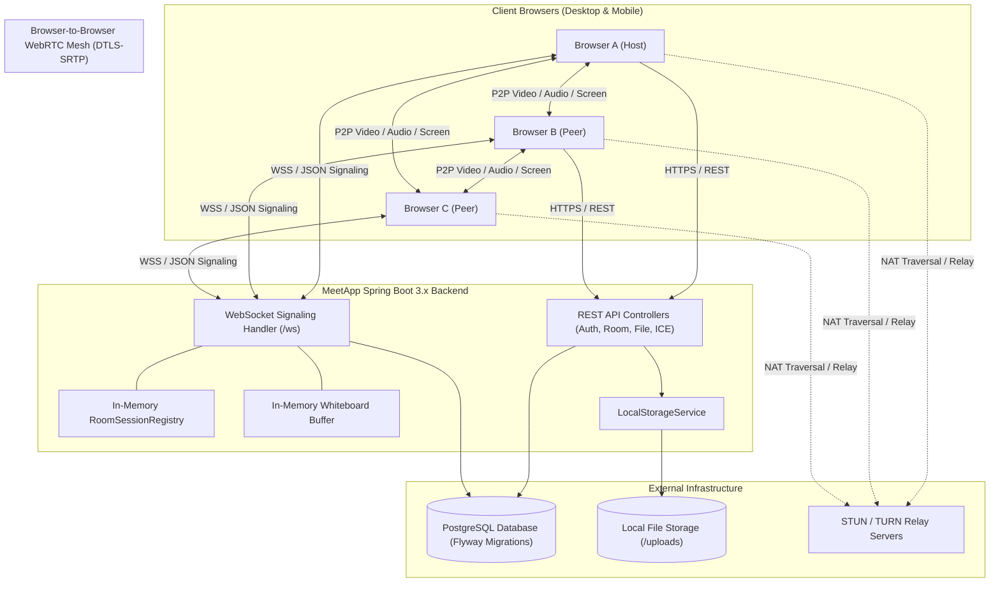

### 2.2 Layer Diagram
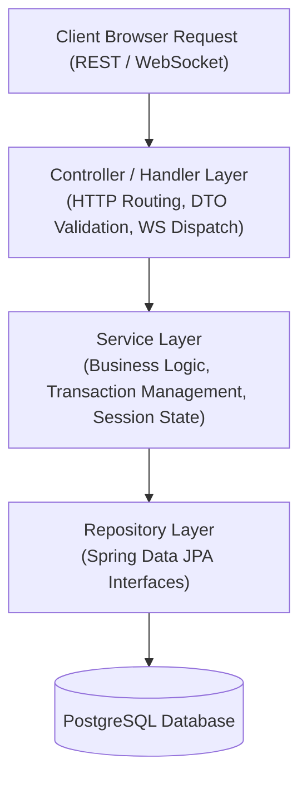

### 2.3 Backend Feature-Dependency Diagram
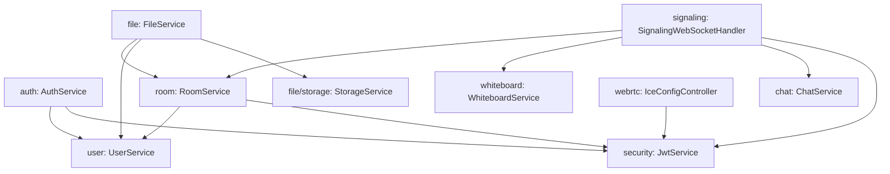

### 2.4 WebRTC Mesh Setup & Lifecycle Sequence Diagram

**Perfect Negotiation Role Definition:**
To eliminate offer glare and collision without unpredictable race conditions, MeetApp implements the W3C WebRTC Perfect Negotiation pattern where peer roles are deterministically assigned based on numeric user IDs:
- **Polite Peer:** The participant with the **lower user ID** (`self.userId < peer.userId`) is designated **polite**. If an offer arrives while waiting for an answer to a local offer, the polite peer rolls back its pending local description (`rollback`) and accepts the incoming remote offer.
- **Impolite Peer:** The participant with the **higher user ID** (`self.userId > peer.userId`) is designated **impolite**. If a collision offer arrives, the impolite peer ignores the incoming offer and continues waiting for an answer to its own offer.
- **Initial Offer Rule:** Under normal join flows, the **newer participant** (joining later) sends offers to all existing peers listed in its `join` confirmation; existing peers answer.

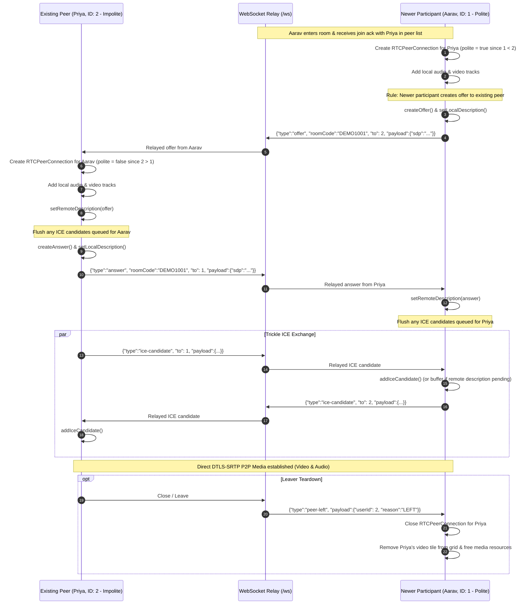

---

## 3. Tech Stack Table

| Layer | Technology | Purpose |
| :--- | :--- | :--- |
| **Backend Runtime** | Java 17 | Core programming language running on modern LTS runtime. |
| **Framework** | Spring Boot 3.x | Enterprise application container, dependency injection, and auto-configuration. |
| **Web & REST** | Spring Web (MVC) | RESTful API endpoints for authentication, room lifecycle, and file transfer. |
| **Email & 2FA** | Resend API / Spring RestClient | Dispatches 6-digit OTP verification emails via Resend HTTPS API (console logging in dev). |
| **Signaling** | Spring WebSocket | Plain WebSocket handler (`TextWebSocketHandler`) exchanging JSON envelopes. |
| **Security & Auth** | Spring Security 6 & JJWT | Stateless authentication, BCrypt password hashing, and JWT authorization filter. |
| **Data Persistence** | Spring Data JPA & Hibernate | Object-Relational Mapping (ORM) connecting via standard PostgreSQL JDBC. |
| **Schema Migration** | Flyway | Versioned database migrations (`V1` to `V5`); `ddl-auto=validate`. |
| **Database Host** | PostgreSQL 15+ | Managed or containerized PostgreSQL instance accessed via standard JDBC. |
| **File Storage** | Local Disk (`StorageService`) | Ephemeral server disk storage with file path sanitization and metadata tracking. |
| **Media Engine** | Browser WebRTC API | Direct peer-to-peer audio, video, and screen sharing (`RTCPeerConnection`). |
| **NAT Traversal** | STUN / TURN | Session traversal and relay utilities configured via dynamic backend API. |
| **Collaborative Canvas**| HTML5 Canvas API | Low-latency 2D stroke rendering and WebSocket synchronization. |
| **Frontend Client** | HTML5, CSS3, Vanilla ES6 JS | Lightweight modular client served directly from `src/main/resources/static`. |
| **API Documentation** | SpringDoc OpenAPI (Swagger 3) | Interactive REST API documentation and specification endpoints. |
| **Observability** | Spring Boot Actuator & SLF4J | Health probes (`/actuator/health`), metrics, and structured logging. |

---

## 4. Complete Project Map

```
meetapp/
├── pom.xml                                     # Maven build definition, Spring Boot 3 dependencies, JJWT, Flyway, Postgres driver
├── Dockerfile                                  # Multi-stage container build packaging Java 17 executable JAR
├── docker-compose.yml                          # Local development orchestrator (Spring Boot app + local PostgreSQL container)
├── .env.example                                # Template for required environment variables (names only, no secrets)
├── .gitignore                                  # Git exclusion rules for /target, /uploads, IDE, and OS artifacts
├── AGENTS.md                                   # Strict engineering guardrails and rules for autonomous AI agents
├── README.md                                   # Project summary, quickstart guide, setup instructions, and demo guide
├── docs/                                       # Project documentation and specifications
│   ├── PRD.md                                  # Product Requirements Document: user personas, FRs, NFRs, scope (implements FR-1..26)
│   ├── ARCHITECTURE.md                         # Architecture Design Document: system diagrams, packages, APIs, protocols
│   ├── DATABASE.md                             # Database design, ER diagram, Flyway migration scripts, and index strategy
│   ├── API.md                                  # Complete REST API specifications and WebSocket JSON signaling message formats
│   ├── SECURITY.md                             # Security guidelines: JWT lifecycle, BCrypt, sanitization, CORS, and DTLS-SRTP
│   └── TASKS.md                                # Master task tracking checklist ordered by component dependencies
└── src/
    ├── main/
    │   ├── java/com/codealpha/meetapp/
    │   │   ├── MeetAppApplication.java         # Spring Boot entry point and main application bootstrap
    │   │   ├── common/                         # Shared utilities, configuration beans, and cross-cutting exceptions
    │   │   │   ├── config/
    │   │   │   │   ├── AppProperties.java      # Type-safe configuration properties (@ConfigurationProperties)
    │   │   │   │   ├── CorsConfig.java         # Global CORS configuration mapping allowed frontend origins
    │   │   │   │   └── JacksonConfig.java      # JSON ObjectMapper customization for Java time and message serialization
    │   │   │   ├── exception/
    │   │   │   │   ├── ApiError.java           # Standard API error response DTO (timestamp, status, error, message, path)
    │   │   │   │   ├── GlobalExceptionHandler.java # Central @RestControllerAdvice translating exceptions to ApiError
    │   │   │   │   ├── NotFoundException.java  # HTTP 404 translation for missing entities (rooms, users, files)
    │   │   │   │   ├── ForbiddenException.java # HTTP 403 translation for unauthorized room access
    │   │   │   │   └── RoomFullException.java  # HTTP 409/400 translation when room exceeds 5 participants (FR-7)
    │   │   │   └── util/
    │   │   │       ├── DateUtil.java           # Standardized ISO-8601 UTC timestamp helper methods
    │   │   │       └── IdGenerator.java        # Cryptographically secure random identifier generator
    │   │   ├── security/                       # Spring Security configuration, JWT handling, and auth filters
    │   │   │   ├── SecurityConfig.java         # SecurityFilterChain configuration, stateless session, public vs protected routes
    │   │   │   ├── JwtService.java             # Token generation, claims parsing, signature validation, and expiry checks (FR-3)
    │   │   │   ├── JwtAuthFilter.java          # Per-request OncePerRequestFilter extracting and validating Bearer tokens
    │   │   │   ├── CustomUserDetailsService.java # Bridges Spring Data User entity to Spring Security UserDetails
    │   │   │   └── RateLimitFilter.java        # Optional token bucket filter protecting auth and file upload endpoints
    │   │   ├── auth/                           # User registration, login, and token issuance (FR-1..4)
    │   │   │   ├── AuthController.java         # REST endpoints for /register, /login, /verify-otp, /resend-otp
    │   │   │   ├── AuthService.java            # Business logic for credentials, OTP validation, and token issue
    │   │   │   └── dto/
    │   │   │       ├── RegisterRequest.java    # Registration payload with Bean Validation annotations (FR-1, FR-2)
    │   │   │       ├── LoginRequest.java       # Login credentials payload (FR-3)
    │   │   │       ├── LoginInitResponse.java  # Step 1 response: {otpRequired, challengeId, maskedEmail, expiresInSeconds}
    │   │   │       ├── VerifyOtpRequest.java   # Step 2 verification payload: {challengeId, otp}
    │   │   │       ├── ResendOtpRequest.java   # Resend OTP payload: {challengeId}
    │   │   │       └── AuthResponse.java       # Authentication response holding JWT token and user summary
    │   │   ├── otp/                            # Two-step email OTP challenges and lifecycle
    │   │   │   ├── OtpChallenge.java           # JPA entity mapping otp_challenges table
    │   │   │   ├── OtpChallengeRepository.java # Repository for challenge lookup by ID and user
    │   │   │   ├── OtpService.java             # Challenge generation, hashing, attempt tracking, and validation
    │   │   │   └── OtpGenerator.java           # Cryptographically secure 6-digit random generator (SecureRandom)
    │   │   ├── email/                          # Email notifications and OTP delivery
    │   │   │   ├── EmailService.java           # Interface defining sendOtpEmail()
    │   │   │   ├── ResendEmailService.java     # Resend HTTPS API implementation
    │   │   │   └── LogEmailService.java        # Dev-profile console logging implementation
    │   │   ├── user/                           # User entity and profile management
    │   │   │   ├── User.java                   # JPA entity mapping the users table (id, name, email, password_hash, created_at)
    │   │   │   ├── UserRepository.java         # Spring Data repository for user lookups by email
    │   │   │   ├── UserService.java            # User retrieval and profile query service
    │   │   │   ├── UserController.java         # Endpoint for /api/users/me returning authenticated user details
    │   │   │   └── dto/
    │   │   │       └── UserResponse.java       # User profile DTO excluding sensitive password hashes
    │   │   ├── room/                           # Meeting room lifecycle, memberships, and capacity limits (FR-4..7)
    │   │   │   ├── Room.java                   # JPA entity mapping rooms table (id, room_code, host_id, is_active, created_at, ended_at)
    │   │   │   ├── RoomParticipant.java        # JPA entity mapping room_participants junction (id, room_id, user_id, joined_at, left_at)
    │   │   │   ├── RoomRepository.java         # Spring Data queries for active rooms by code
    │   │   │   ├── RoomParticipantRepository.java # Queries for active room membership and count checks
    │   │   │   ├── RoomService.java            # Logic for creating rooms, verifying capacity (<5), leaving, and ending meetings
    │   │   │   ├── RoomController.java         # REST endpoints for /api/rooms, /api/rooms/{code}, and /api/rooms/{code}/end
    │   │   │   ├── RoomCodeGenerator.java      # Generates unguessable alphanumeric codes (e.g., ABC-DEF-GHI)
    │   │   │   ├── RoomEndedEvent.java         # Spring ApplicationEvent published when host terminates a room
    │   │   │   └── dto/
    │   │   │       ├── CreateRoomRequest.java  # Optional room creation parameters
    │   │   │       ├── RoomResponse.java       # Room metadata DTO (code, host, active participants, created_at)
    │   │   │       └── ParticipantResponse.java # Active participant summary DTO
    │   │   ├── signaling/                      # Real-time WebSocket signaling, sessions, and dispatch (FR-8..14, FR-22..25)
    │   │   │   ├── WebSocketConfig.java        # Registers SignalingWebSocketHandler at /ws with interceptors and limits
    │   │   │   ├── JwtHandshakeInterceptor.java # Authenticates token/ticket, verifies Origin, validates active room membership
    │   │   │   ├── RoomSessionRegistry.java    # Thread-safe in-memory map: roomCode -> userId -> WebSocketSession with serialized sends
    │   │   │   ├── SignalingWebSocketHandler.java # Handles text messages, rate limits, session lifecycle (connect, disconnect, grace period)
    │   │   │   ├── message/
    │   │   │   │   ├── SignalMessage.java      # Generic envelope DTO: {type, roomCode, from, to, payload}
    │   │   │   │   └── MessageType.java        # Enum of all signaling event types (join, peer-joined, peer-left, ping, pong, room-ended, error, etc.)
    │   │   │   └── handler/
    │   │   │       ├── MessageHandler.java     # Interface for modular message processors
    │   │   │       ├── JoinHandler.java        # Validates membership, sends join ack with peer list, broadcasts peer-joined (FR-4)
    │   │   │       ├── HeartbeatHandler.java   # Handles ping messages and returns immediate pong responses
    │   │   │       ├── WebRtcRelayHandler.java # Relays P2P offer, answer, and ice-candidate messages to targeted peer (FR-8..11)
    │   │   │       ├── MuteStatusHandler.java  # Broadcasts audio/video mute status to peers and records state in registry
    │   │   │       ├── ChatHandler.java        # Validates, persists, and broadcasts chat messages to room (Phase 9)
    │   │   │       ├── WhiteboardHandler.java  # Buffers stroke events and broadcasts draw/clear to peers (Phase 11)
    │   │   │       └── ScreenShareHandler.java # Broadcasts screen-share-start and stop events (Phase 8)
    │   │   ├── webrtc/                         # WebRTC configuration and dynamic ICE credentials
    │   │   │   ├── IceConfigController.java    # Serves STUN/TURN server URLs and credentials at /api/webrtc/ice-config
    │   │   │   └── dto/
    │   │   │       ├── IceServerResponse.java  # DTO representing a single STUN/TURN configuration entry
    │   │   │       └── IceConfigResponse.java  # DTO delivering ICE server lists to frontend client
    │   │   ├── whiteboard/                     # Collaborative whiteboard stroke storage and state replay (FR-18..21)
    │   │   │   ├── WhiteboardService.java      # In-memory thread-safe room stroke registry, cap enforcement, chunking
    │   │   │   ├── WhiteboardStroke.java       # Immutable stroke entity (id, ownerId, tool, color, width, points, final)
    │   │   │   ├── WhiteboardPoint.java        # Normalized 2D coordinate model [0.0 .. 1.0]
    │   │   │   └── dto/
    │   │   │       ├── DrawSegmentPayload.java # Incoming & broadcast draw segment payload
    │   │   │       ├── StrokeUndoPayload.java  # Payload for stroke undo requests
    │   │   │       └── BoardStateChunkPayload.java # Chunked board state payload for late-joiner replay
    │   │   ├── chat/                           # In-room text messaging (FR-22, FR-23)
    │   │   │   ├── ChatMessage.java            # JPA entity mapping messages table (id, room_id, sender_id, content, sent_at)
    │   │   │   ├── ChatMessageRepository.java  # Spring Data repository querying recent room chat history
    │   │   │   ├── ChatService.java            # Logic for persisting chat records and formatting broadcast payloads
    │   │   │   └── dto/
    │   │   │       └── ChatMessageDto.java     # Outgoing chat message DTO with sender name and ISO timestamp
    │   │   ├── file/                           # File sharing and download management (FR-15..17)
    │   │   │   ├── FileController.java         # REST endpoints for /api/files/upload/{code}, download/{id}, delete/{id}, and file list
    │   │   │   ├── FileService.java            # Business logic for file validation, storage, metadata persistence, quotas, and downloads
    │   │   │   ├── FileMeta.java               # JPA entity mapping files table (id, room_id, uploader_id, original_name, stored_name, content_type, size_bytes, uploaded_at)
    │   │   │   ├── FileMetaRepository.java     # Spring Data repository querying files uploaded to an active room with cursor support
    │   │   │   ├── FileValidator.java          # Validates file size (<=10MB), extension allow-list, magic bytes, and blocks double extensions
    │   │   │   ├── storage/
    │   │   │   │   ├── StorageService.java     # Interface defining storeFile(), loadAsResource(), and deleteFile()
    │   │   │   │   ├── LocalStorageService.java # Implementation writing files to local disk directory with sanitized UUID names
    │   │   │   │   └── StorageException.java   # Centralized storage I/O exception
    │   │   │   ├── retention/
    │   │   │   │   └── FileRetentionCleaner.java # Scheduled batch cleanup for files of ended/abandoned rooms
    │   │   │   └── dto/
    │   │   │       ├── FileUploadResponse.java # Upload confirmation DTO
    │   │   │       ├── FileItemDto.java        # Metadata DTO for room files list
    │   │   │       └── FileListResponse.java   # Cursor pagination wrapper DTO
    │   │   └── crypto/                         # Optional payload encryption utilities (FR-26)
    │   │       └── EncryptionService.java      # Optional AES-GCM 256-bit encryption/decryption helper for sensitive buffers
    │   └── resources/
    │       ├── application.yml                 # Base Spring Boot configuration (JPA, Flyway, file limits, actuator)
    │       ├── application-dev.yml             # Local dev profile (Postgres localhost, relaxed logging, debug mode)
    │       ├── application-prod.yml            # Production profile (PostgreSQL with sslmode=require, strict CORS)
    │       ├── db/migration/                   # Flyway versioned SQL migration scripts
    │       │   ├── V1__baseline_check.sql          # Bootstrap baseline check
│       │   ├── V2__create_users.sql            # Creates users table and email unique check
│       │   ├── V3__create_rooms.sql            # Creates rooms table with host foreign key
│       │   ├── V4__create_room_participants.sql # Creates room_participants junction table
│       │   ├── V5__create_files.sql            # Creates files metadata table
│       │   ├── V6__create_messages.sql         # Creates messages table with content check
│       │   ├── V7__create_otp_challenges.sql   # Creates otp_challenges table with resend_count
│       │   ├── V8__create_indexes.sql          # Creates performance indexes
│       │   └── V9__enable_row_level_security.sql # Enables Row Level Security on all application tables
    │       └── static/                         # Frontend client files (HTML5, CSS3, modular JavaScript)
    │           ├── index.html                  # Landing page introducing MeetApp features and navigation
    │           ├── login.html                  # User login page with email/password form
    │           ├── signup.html                 # User registration page with client-side password strength validation
    │           ├── dashboard.html              # Authenticated user hub: create meeting, join by code, recent meetings
    │           ├── profile.html                # User profile management: display details, change password, delete account
    │           ├── prejoin.html                # Pre-meeting hardware test: camera preview, mic level, toggle state (FR-8)
    │           ├── room.html                   # Main collaboration room: video grid, whiteboard, chat, files drawer
    │           ├── ended.html                  # Post-meeting screen showing summary and redirect to dashboard
    │           ├── manifest.json               # Optional Web App Manifest for browser installation
    │           ├── service-worker.js           # Optional Service Worker for offline asset caching
    │           ├── css/
    │           │   ├── base.css                # Global CSS reset, typography, theme variables, and responsive layout
    │           │   ├── auth.css                # Styling for authentication forms and card containers
    │           │   ├── app.css                 # Core authenticated application styles: header top bar, left navigation, modals, buttons
    │           │   ├── dashboard.css           # Home page specific layout: week calendar strip, meetings list, empty state illustration, device check
    │           │   └── room.css                # Layout for video grid, floating toolbar, drawers, and whiteboard canvas
    │           └── js/
    │               ├── config.js               # Central runtime configuration: API base URLs, WS endpoints, timeouts, MOCK switch
    │               ├── api.js                  # Fetch API wrapper appending Bearer JWT, handling 401 redirection, and mock adapter
    │               ├── auth.js                 # Login/registration form handling, token persistence in sessionStorage, logout
    │               ├── layout.js               # Shared header top bar, account dropdown, route guard, left/bottom navigation
    │               ├── week-strip.js           # Sunday-to-Saturday calendar strip with day selection, navigation, and meeting markers
    │               ├── devicecheck.js          # On-demand media hardware test (camera preview, audio level bar, device selectors, track cleanup)
    │               ├── dashboard.js            # Home page orchestration: code/link parser, New meeting dropdown, daily meeting list, modals
    │               ├── profile.js              # Profile logic: name updates, password change, account deletion confirmation
    │               ├── socket.js               # WebSocket client managing connection, reconnection, heartbeat, and send()
    │               ├── prejoin.js              # Pre-join room gate: validates room, shows peers, camera preview, mic meter, device toggles
    │               ├── media.js                # Local media stream lifecycle: getUserMedia, track toggles, replaceTrack, audio level analysis
    │               ├── peers.js                # WebRTC mesh engine: RTCPeerConnection pool, perfect negotiation, candidate queue, bitrate caps
    │               ├── grid.js                 # Video grid layout (1-5 participants), speaking indicators, muted avatars, pin/enlarge
    │               ├── participants.js         # Room presence manager: renders active participants list, updates live join/leave notices via aria-live
    │               ├── room.js                 # Meeting room coordinator: binds media, peers, grid, control toolbar, and leave/end actions
    │               ├── screenshare.js          # Screen capture logic: getDisplayMedia, track replacement, revert to camera (FR-12)
    │               ├── chat.js                 # Chat drawer UI, message rendering, unread badge counter (FR-22, FR-23)
    │               ├── files.js                # File upload handling, progress indication, drawer listing, downloads (FR-15)
    │               └── whiteboard.js           # HTML5 Canvas drawing engine: stroke capture, tool selection, canvas sync (FR-18)
    └── test/
        └── java/com/codealpha/meetapp/         # Unit and integration test suite mirroring production structure
            ├── auth/
            │   └── AuthServiceTest.java        # Unit test verifying registration validation, password hashing, and login
            ├── room/
            │   └── RoomServiceTest.java        # Unit test verifying room creation, 5-user capacity limit, and host closing
            ├── file/
            │   └── FileValidatorTest.java      # Unit test verifying 10MB limits, whitelist extensions, and blocking .exe
            └── signaling/
                └── RoomSessionRegistryTest.java # Unit test verifying session registration, multi-tab replacement, and teardown
```

---

## 5. Component Responsibility Table

### 5.1 Backend Feature Packages
| Package | Component | Responsibility | Depends On | Technology |
| :--- | :--- | :--- | :--- | :--- |
| `common` | `GlobalExceptionHandler`, `CorsConfig` | Catches exceptions and maps to uniform `ApiError`; sets CORS headers. | None | Spring MVC, Jackson |
| `security` | `JwtService`, `JwtAuthFilter` | Generates/validates JWTs; filters HTTP requests; checks WS handshake. | `CustomUserDetailsService` | JJWT, Spring Security |
| `auth` | `AuthController`, `AuthService` | User registration, credential check, OTP challenge initiation, token issuance. | `UserService`, `OtpService`, `JwtService` | Spring Web, BCrypt |
| `otp` | `OtpService`, `OtpGenerator`, `OtpChallengeRepository` | SecureRandom 6-digit OTP generation, SHA-256 hashing at rest, expiry/attempt validation. | `EmailService` | Spring Data JPA, SecureRandom |
| `email` | `EmailService`, `ResendEmailService`, `LogEmailService` | Resend HTTPS API delivery of OTP verification emails; console logging in dev profile. | None | Spring RestClient, Resend API |
| `user` | `UserService`, `UserRepository`, `UserController` | Retrieves user profile data, persists user accounts, serves user room history range queries (`/api/users/me/rooms`). | None | Spring Data JPA |
| `room` | `RoomService`, `RoomRepository` | Creates rooms (decoupled host participant entry), generates codes, validates max 5 capacity, ends meetings. | `UserService` | Spring Data JPA |
| `signaling`| `SignalingWebSocketHandler`, `RoomSessionRegistry` | Authenticates WebSocket sessions, tracks in-memory peer map, dispatches messages, manages reconnect grace period. | `RoomService`, `WhiteboardService`, `ChatService` | Spring WebSocket |
| `webrtc` | `IceConfigController` | Provides client with dynamic STUN/TURN server URLs and credentials. | `AppProperties` | Spring Web |
| `whiteboard`| `WhiteboardService` | Maintains in-memory ordered list of strokes per room; serves state to late joiners. | None | Java Collections |
| `chat` | `ChatService`, `ChatMessageRepository` | Persists text messages, enriches with sender name/timestamp, formats broadcasts. | `RoomService`, `UserService` | Spring Data JPA |
| `file` | `FileService`, `LocalStorageService` | Validates file size/type, stores on disk with UUID, tracks metadata in DB. | `RoomService`, `FileValidator` | Spring Data JPA, Java NIO |
| `crypto` | `EncryptionService` | Provides AES-GCM-256 encryption/decryption utilities for optional payload protection. | None | Java Cryptography (JCE)|

### 5.2 Frontend Modules
| File / Module | Responsibility | Depends On | Technology |
| :--- | :--- | :--- | :--- |
| `config.js` | Single source of truth for backend URLs, WebSocket paths, and constants. | None | Vanilla ES6 |
| `api.js` | Generic HTTP client wrapper injecting `Authorization: Bearer <token>` and handling errors. | `config.js` | Fetch API |
| `auth.js` | Handles registration and login form submissions, stores JWT, manages logout. | `api.js`, `config.js` | Vanilla JS, DOM |
| `layout.js` | Shared header top bar, wordmark, code/link input, New dropdown, Help/Settings buttons, initials avatar, account dropdown, route guard. | `auth.js`, `api.js` | Vanilla JS, DOM |
| `week-strip.js` | Calendar strip (Sun-Sat) with local timezone calculation, day selection, week nav (prev/next/today), and meeting markers. | None | Vanilla JS, DOM |
| `devicecheck.js` | On-demand camera preview, microphone volume level meter, device select enumeration, hardware error reporting, track cleanup. | None | WebRTC MediaStream, Web Audio API |
| `dashboard.js`| Binds home screen interactions: week strip updates, daily meetings rendering, empty state, link creation modals, copy utilities. | `layout.js`, `week-strip.js`, `devicecheck.js`, `api.js`, `config.js` | Vanilla JS, DOM |
| `profile.js` | Binds profile forms (update name, change password with strength meter, delete account). | `layout.js`, `api.js`, `auth.js` | Vanilla JS, DOM |
| `socket.js` | Connects to `/ws`, manages heartbeat ping/pong, automatic reconnection with backoff/jitter, and serializes/deserializes JSON. Includes mock socket adapter for MOCK mode. | `config.js` | WebSocket API |
| `prejoin.js`| Validates room code via REST, queries active participants, shows camera preview placeholder, calls room join endpoint. | `api.js`, `auth.js`, `config.js` | Vanilla JS, DOM |
| `participants.js`| Renders active participants list with Host/Guest markers, binds live peer-joined and peer-left updates with aria-live announcements. | None | Vanilla JS, DOM |
| `room.js` | Orchestrates room page shell: connection status indicator, top bar, disabled tool placeholders, leave/end actions. | `socket.js`, `participants.js`, `api.js`, `auth.js` | Vanilla JS, DOM |
| `screenshare.js`| Invokes `getDisplayMedia()`, executes track replacement on active peer connections. | `webrtc.js`, `socket.js` | WebRTC Display API |
| `chat.js` | Handles sending and receiving text chat, renders message bubbles, updates unread badge. | `socket.js` | Vanilla JS, DOM |
| `files.js` | Manages file drag-and-drop, calls REST upload/download endpoints, updates file drawer. | `api.js`, `socket.js` | Fetch API, FormData |
| `whiteboard.js`| Captures canvas mouse/touch coordinates, renders strokes, broadcasts events, handles sync. | `socket.js` | HTML5 Canvas 2D |

---

## 6. Backend Layer Rules
To guarantee maintainability, code modularity, and clean isolation:
1. **Controller Layer:** Controllers must only handle HTTP routing, request binding, Bean Validation triggering (`@Valid`), and DTO response mapping. Controllers must contain zero business logic or direct database access.
2. **Service Layer:** All business logic, transaction boundaries (`@Transactional`), security checks, and cross-feature orchestration must reside exclusively in services. Services communicate with other features via their public Service interfaces—never by directly injecting another feature's Repository.
3. **Repository Layer:** Repositories must inherit from `JpaRepository` and contain only database access queries.
4. **DTO Discipline:** JPA entities (`User`, `Room`, `FileMeta`, `ChatMessage`) must never be accepted as Controller parameters or returned directly in REST responses or WebSocket payloads. Dedicated Request and Response DTOs must be used everywhere.
5. **Constructor Injection:** Field injection (`@Autowired` on class fields) is strictly prohibited. All dependencies must be injected via constructor injection (using Lombok `@RequiredArgsConstructor` or explicit public constructors).
6. **Input Validation:** All incoming request payloads must be validated using Bean Validation annotations (`@NotBlank`, `@NotNull`, `@Size`, `@Email`, etc.).

---

## 7. Database Summary & Architecture Rules

### 7.1 Relational Schema Summary
The database contains relational tables managed via Flyway. Full DDL scripts reside in `docs/DATABASE.md`:
- `users`: Stores user identity, authentication, and credentials (`id`, `email`, `password_hash`, `full_name`, `created_at`, `updated_at`). Email is unique and indexed.
- `rooms`: Tracks meeting room instances (`id`, `room_code`, `host_user_id`, `is_active`, `created_at`, `ended_at`). `room_code` is unique and indexed. Foreign key references `users(id)`.
- `room_participants`: Tracks participant membership history (`id`, `room_id`, `user_id`, `joined_at`, `left_at`). Foreign keys reference `rooms(id)` and `users(id)`.
- `files`: Tracks metadata for files shared in rooms (`id`, `room_id`, `uploader_id`, `original_filename`, `stored_filename`, `file_size`, `content_type`, `created_at`). Foreign keys reference `rooms(id)` and `users(id)`.
- `messages`: Persists text chat history for auditability (`id`, `room_id`, `sender_id`, `content`, `sent_at`). Foreign keys reference `rooms(id)` and `users(id)`.
- `otp_challenges`: Tracks two-step verification challenges (`id`, `user_id`, `otp_hash`, `expires_at`, `attempts`, `consumed`, `created_at`, `last_sent_at`).
- *Whiteboard strokes are stored exclusively in backend in-memory buffers* for the duration of the active room session; they are not persisted to SQL tables.

### 7.2 Database Hosting and Security Rules
1. **Raw Database Authority:** PostgreSQL is used strictly as a relational database. All authentication, validation, signaling, and business logic reside entirely within Spring Boot.
2. **Flyway Ownership:** The database schema is strictly owned and managed by Flyway versioned migrations (`src/main/resources/db/migration/V1__*.sql` through `V7__*.sql`). Hibernate auto-DDL is permanently locked to `spring.jpa.hibernate.ddl-auto=validate`. Developers must never manually alter tables out-of-band.
3. **Connection Security:** Database connections are supplied via environment variables (`DB_URL`, `DB_USER`, `DB_PASSWORD`) and mandate SSL encryption (`sslmode=require`) in production.
4. **Row-Level Security & Exposure:** Row-level security is configured as defense-in-depth, protecting user credentials and meeting records.
5. **Portability:** The connection string in `DB_URL` points seamlessly to local Docker Compose PostgreSQL or any cloud PostgreSQL provider without code modifications.

---

## 8. REST API Summary

All endpoints return and accept standard JSON payloads. Protected endpoints require the `Authorization: Bearer <JWT>` header.

| HTTP Method | Endpoint Path | Authentication | Purpose | PRD Trace |
| :--- | :--- | :--- | :--- | :--- |
| `POST` | `/api/auth/register` | Public | Register new user account with validated email and password. | FR-1, FR-2 |
| `POST` | `/api/auth/login` | Public | Authenticate credentials and return signed JWT token. | FR-3 |
| `GET` | `/api/users/me` | Authenticated | Retrieve profile details of currently authenticated user. | FR-1 |
| `POST` | `/api/rooms` | Authenticated | Create a new meeting room and return generated room code. | FR-4 |
| `GET` | `/api/rooms/{code}` | Authenticated | Validate room code existence and check capacity limit (<5). | FR-5, FR-7 |
| `POST` | `/api/rooms/{code}/end` | Authenticated (Host) | Terminate meeting room session for all connected members. | FR-6 |
| `GET` | `/api/rooms/{code}/files` | Authenticated (Member) | Retrieve list of files uploaded to the active room. | FR-17 |
| `POST` | `/api/files/upload/{code}` | Authenticated (Member) | Upload a file ($\le 10\text{MB}$) to the specified room. | FR-15, FR-16|
| `GET` | `/api/files/download/{id}` | Authenticated (Member) | Download file binary stream by file metadata ID. | FR-17 |
| `GET` | `/api/webrtc/ice-config` | Authenticated | Retrieve active STUN and TURN server configuration. | FR-24 |
| `GET` | `/actuator/health` | Public | Health probe endpoint for Docker and cloud platform checks. | NFR-4 |

### Standard JSON Error Format
All exceptions intercepted by `GlobalExceptionHandler` return an identical JSON structure:
```json
{
  "timestamp": "2026-11-09T05:30:00Z",
  "status": 400,
  "error": "Bad Request",
  "message": "File size exceeds maximum permitted limit of 10 MB",
  "path": "/api/files/upload/ABC-DEF"
}
```

---

## 9. WebSocket Signaling Protocol

The signaling channel connects at:  
`ws://<host>:<port>/ws?token=<JWT>&room=<code>` (or `wss://` in production).

### 9.1 Signaling Message Envelope
All messages exchanged over the WebSocket connection conform to the following JSON envelope:
```json
{
  "type": "offer",
  "roomCode": "ABC-DEF",
  "from": "user-uuid-1",
  "to": "user-uuid-2",
  "payload": {}
}
```
*Security Guarantee:* The server always sets the `from` field using the verified user ID extracted from the authenticated session during the handshake. The server never trusts or accepts a client-provided `from` field.

### 9.2 Signaling Event Types
| Message Type | Direction | Payload Structure | Description |
| :--- | :--- | :--- | :--- |
| `join` | Client $\to$ Server | `{}` | Client announces room entry after socket opens. |
| `peer-joined` | Server $\to$ Client | `{"userId": "...", "fullName": "..."}` | Broadcasts to existing peers that a new user connected. |
| `peer-left` | Server $\to$ Client | `{"userId": "..."}` | Broadcasts that a user disconnected or left. |
| `offer` | Client $\to$ Server $\to$ Client | `{"sdp": "..."}` | Direct WebRTC SDP offer relayed to peer identified in `to`. |
| `answer` | Client $\to$ Server $\to$ Client | `{"sdp": "..."}` | Direct WebRTC SDP answer relayed to peer identified in `to`. |
| `ice-candidate`| Client $\to$ Server $\to$ Client | `{"candidate": "..."}` | ICE candidate relayed to peer identified in `to`. |
| `chat` | Bidirectional | `{"text": "...", "timestamp": "..."}` | In-room group text message broadcast to all members. |
| `draw` | Bidirectional | `{"tool": "pen", "color": "#000", "size": 2, "prevX": 10, "prevY": 10, "x": 15, "y": 15}` | Whiteboard stroke coordinates broadcast to room peers. |
| `clear-board` | Bidirectional | `{}` | Requests or notifies canvas clear across all peers. |
| `board-state` | Server $\to$ Client | `{"strokes": [...]}` | Transmits complete stroke history buffer to late joiners. |
| `screen-share-start` | Client $\to$ Server $\to$ Client | `{"userId": "..."}` | Notifies peers that participant initiated screen sharing. |
| `screen-share-stop` | Client $\to$ Server $\to$ Client | `{"userId": "..."}` | Notifies peers that participant ceased screen sharing. |
| `file-shared` | Server $\to$ Client | `{"fileId": "...", "fileName": "...", "size": 1024, "uploader": "..."}` | Broadcast notification when a file upload completes. |
| `mute-status` | Bidirectional | `{"audioMuted": true, "videoMuted": false}` | Broadcasts mic mute and camera disable state changes. |
| `error` | Server $\to$ Client | `{"code": "ROOM_FULL", "message": "..."}` | Direct error notice before connection termination. |

---

## 10. Key Flows (Mermaid Sequence Diagrams)

### 10.1 User Registration and Two-Step Login (with Email OTP)
```mermaid
sequenceDiagram
    autonumber
    actor User
    participant Browser
    participant AuthController
    participant AuthService
    participant OtpService
    participant EmailService
    participant PostgresDB

    User->>Browser: Enters name, email, password
    Browser->>AuthController: POST /api/auth/register
    AuthController->>AuthService: register(dto)
    AuthService->>AuthService: Validate & Hash password (BCrypt)
    AuthService->>PostgresDB: Insert User record
    PostgresDB-->>AuthService: Confirmed
    AuthService-->>AuthController: User created
    AuthController-->>Browser: HTTP 201 Created

    Note over User, Browser: Step 1: Credential Verification & OTP Challenge
    User->>Browser: Enters email and password
    Browser->>AuthController: POST /api/auth/login
    AuthController->>AuthService: login(credentials)
    AuthService->>PostgresDB: Find User by email
    PostgresDB-->>AuthService: User entity with hash
    AuthService->>AuthService: Verify BCrypt match
    AuthService->>OtpService: createChallenge(user)
    OtpService->>OtpService: Generate 6-digit OTP (SecureRandom) & SHA-256 hash
    OtpService->>PostgresDB: Save otp_challenges (challengeId, hash, expires_at)
    OtpService->>EmailService: sendOtpEmail(email, otp)
    Note over EmailService: In dev mode, OTP is logged to console; in prod, dispatched via Resend HTTPS API
    AuthService-->>AuthController: LoginInitResponse (otpRequired, challengeId, maskedEmail, expiresInSeconds)
    AuthController-->>Browser: HTTP 200 OK (Prompt user for OTP)

    Note over User, Browser: Step 2: OTP Verification & JWT Issuance
    User->>Browser: Enters 6-digit OTP received via email
    Browser->>AuthController: POST /api/auth/verify-otp (challengeId, otp)
    AuthController->>AuthService: verifyOtp(challengeId, otp)
    AuthService->>OtpService: validateAndConsume(challengeId, otp)
    OtpService->>PostgresDB: Find challenge & check attempts/expiry
    OtpService->>OtpService: Constant-time hash match (MessageDigest.isEqual)
    OtpService->>PostgresDB: Mark consumed = TRUE
    AuthService->>AuthService: Generate JWT (24h expiry)
    AuthService-->>AuthController: AuthResponse (JWT + User summary)
    AuthController-->>Browser: HTTP 200 OK + JWT
    Browser->>Browser: Store JWT in localStorage
```

> **Development Mode Note:** When running under the `dev` Spring profile (`application-dev.yml`), the generated 6-digit OTP is output directly to the application logs via SLF4J, allowing full local development and testing without requiring live Resend API credentials. In `prod`, logging raw OTP codes is strictly forbidden.

### 10.2 Create and Join Room with WebSocket Handshake
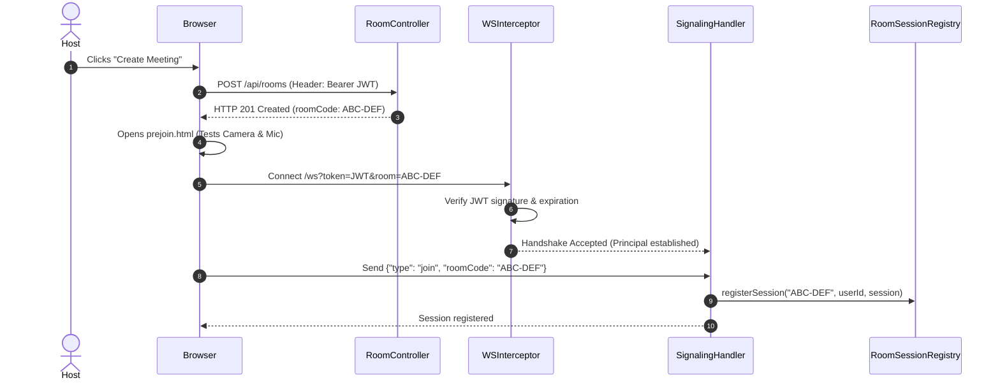

### 10.3 WebRTC Mesh Connection Setup (New User Joins)
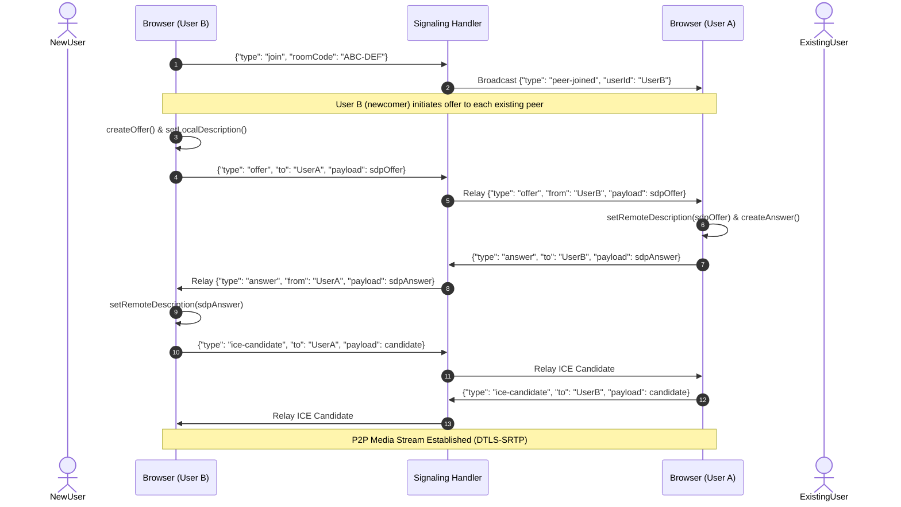

### 10.4 Screen Sharing with Dual-Stream Renegotiation (Phase 8)
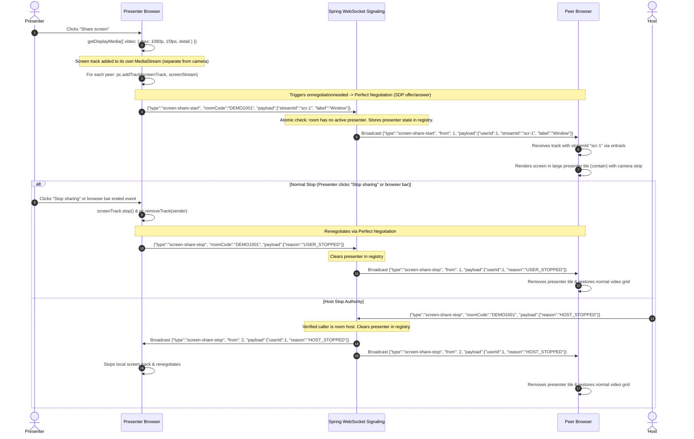

### 10.5 Real-Time Group Chat, Persistence & History Sequence
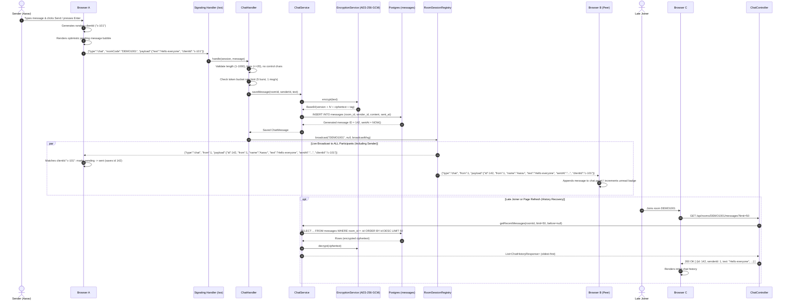

### 10.6 In-Room File Sharing: Upload, Storage, Signaling, Download & Deletion
```mermaid
sequenceDiagram
    autonumber
    actor UserA as Uploader (Aarav)
    participant BrowserA as Browser A
    participant FileCtrl as FileController
    participant FileSvc as FileService
    participant Validator as FileValidator
    participant Storage as LocalStorageService
    participant DB as Postgres (files)
    participant Registry as RoomSessionRegistry
    participant BrowserB as Peer Browser (Priya)

    Note over UserA, BrowserA: 1. File Upload & Validation
    UserA->>BrowserA: Selects file (e.g. report.pdf, 2 MB)
    BrowserA->>FileCtrl: POST /api/files/upload/DEMO1001 (multipart/form-data)
    FileCtrl->>FileSvc: uploadFile("DEMO1001", file, userA.id)
    FileSvc->>FileSvc: Verify User A is active participant in DEMO1001
    FileSvc->>FileSvc: Check room storage quota (<=20 files, <=50 MB)
    FileSvc->>Validator: validateFile(file)
    Validator->>Validator: Verify size <= 10MB, extension allow-list, no double extension
    Validator->>Validator: Inspect stream magic bytes (%PDF-)
    Validator-->>FileSvc: Validated (sanitized display name)

    Note over FileSvc, Storage: 2. Storage & Atomic Persistence
    FileSvc->>Storage: store(fileStream, sanitizedName, roomId, fileId)
    Storage->>Storage: Write to temp file with UUID name
    opt Encryption at Rest (AES-256-GCM)
        Storage->>Storage: Encrypt buffer with random IV & AAD(roomId, fileId)
    end
    Storage->>Storage: Atomic move/rename to final storage directory
    Storage-->>FileSvc: storedName ("uuid-1234.pdf")

    FileSvc->>DB: INSERT INTO files (room_id, uploader_id, original_name, stored_name, content_type, size_bytes)
    DB-->>FileSvc: Generated file ID = 42
    FileSvc-->>FileCtrl: FileUploadResponse(id=42, ...)
    FileCtrl-->>BrowserA: HTTP 201 Created

    Note over FileSvc, Registry: 3. Real-Time Broadcast Notification (Server -> Room)
    Note over FileSvc, Registry: Server broadcasts file-shared strictly AFTER commit; client NEVER emits it
    FileSvc->>Registry: broadcast("DEMO1001", null, file-shared envelope)
    Registry-->>BrowserA: {"type":"file-shared", "payload":{"fileId":42, "originalName":"report.pdf", ...}}
    Registry-->>BrowserB: {"type":"file-shared", "payload":{"fileId":42, "originalName":"report.pdf", ...}}
    BrowserB->>BrowserB: Prepends file to Files list / increments unread badge

    Note over BrowserB, Storage: 4. Secure Streaming Download
    UserB->>BrowserB: Clicks "Download"
    BrowserB->>FileCtrl: GET /api/files/download/42 (with Authorization: Bearer JWT)
    FileCtrl->>FileSvc: loadFileAsResource(fileId=42, userB.id)
    FileSvc->>FileSvc: Verify User B is participant in DEMO1001 (403/404 if not)
    FileSvc->>Storage: loadAsResource(storedName, roomId, fileId)
    Storage-->>FileSvc: Binary InputStream (decrypted if encrypted)
    FileSvc-->>FileCtrl: Resource with headers (attachment, nosniff, no-store)
    FileCtrl-->>BrowserB: HTTP 200 OK (Binary stream)
    BrowserB->>BrowserB: Triggers browser download save dialog

    Note over UserA, Registry: 5. Authorized File Deletion
    UserA->>BrowserA: Clicks "Delete"
    BrowserA->>FileCtrl: DELETE /api/files/42
    FileCtrl->>FileSvc: deleteFile(fileId=42, userA.id)
    FileSvc->>FileSvc: Verify caller is uploader OR meeting host
    FileSvc->>Storage: delete(storedName)
    FileSvc->>DB: DELETE FROM files WHERE id = 42
    FileSvc->>Registry: broadcast("DEMO1001", null, file-deleted { fileId: 42 })
    Registry-->>BrowserA: {"type":"file-deleted", "payload":{"fileId":42}}
    Registry-->>BrowserB: {"type":"file-deleted", "payload":{"fileId":42}}
    BrowserA->>BrowserA: Removes file from list
    BrowserB->>BrowserB: Removes file from list
    FileCtrl-->>BrowserA: HTTP 204 No Content
```

### 10.7 Whiteboard Synchronization and Late-Joiner Catch-Up
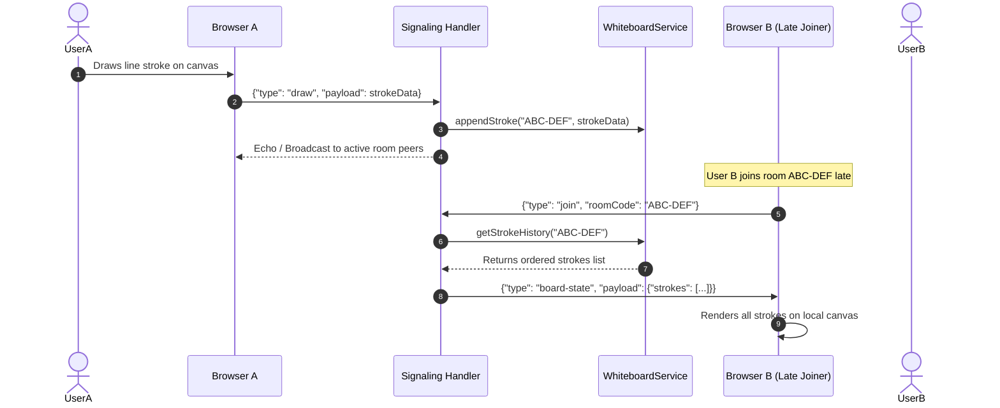

### 10.7 Participant Leave and Resource Cleanup
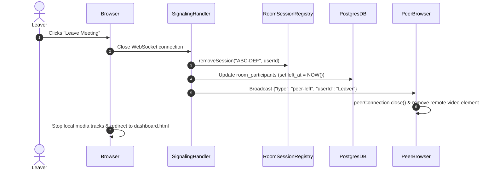

### 10.8 Host Ends Meeting
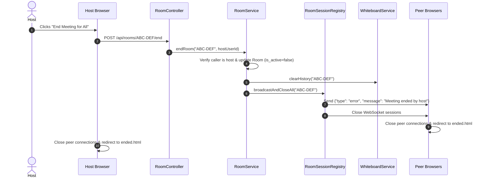

### 10.9 Real-Time Collaborative Whiteboard Flow
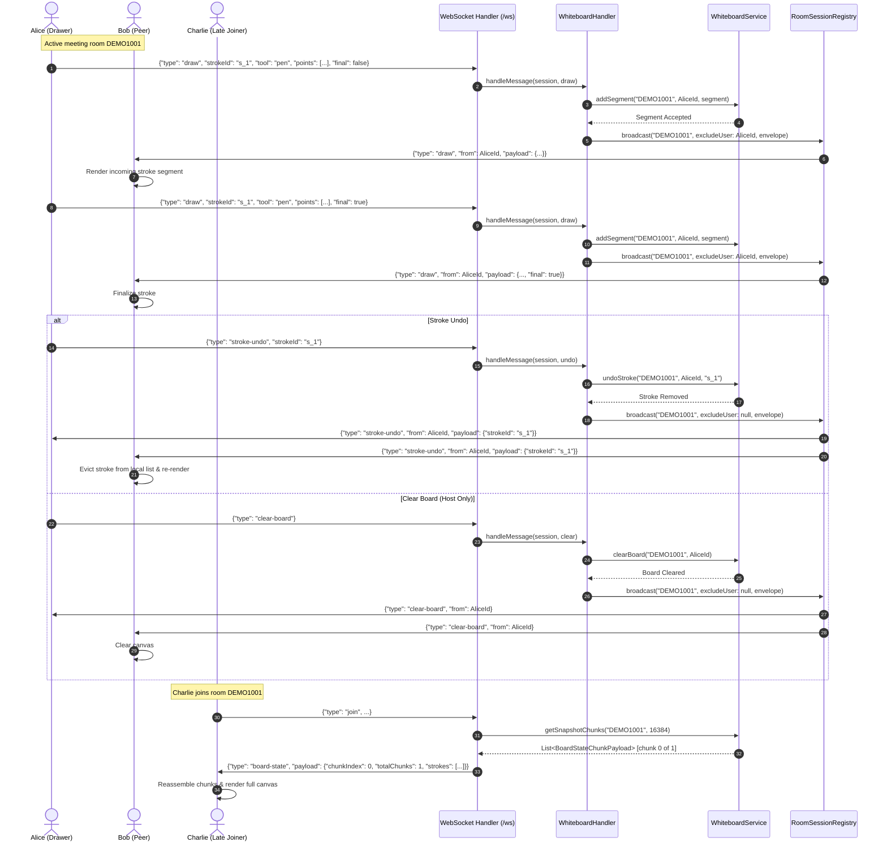

---

## 11. WebRTC Mesh Design

### 11.1 Full Mesh Topology Rationale and Capacity Ceiling
MeetApp implements a peer-to-peer Full Mesh topology where every participant establishes a direct `RTCPeerConnection` with every other participant. 
- *Why Mesh?* Full mesh removes the requirement for expensive media relay servers (SFUs or MCUs). This enables lightweight hosting on free or low-cost cloud tiers with minimal server CPU overhead, as the server never handles media encoding or forwarding.
- *5-Participant Hard Limit:* In a full mesh of $N$ participants, each client maintains $N - 1$ outgoing video/audio streams and receives $N - 1$ incoming streams (total network links: $N \times (N-1)$). Beyond 5 participants (20 total links), standard upstream bandwidth (typically 1–2 Mbps per HD/SD stream) saturates client connections, causing packet drop and CPU throttling. Therefore, the application enforces a strict cap of 5 concurrent participants per room (FR-7).

### 11.2 Dynamic STUN/TURN Negotiation
WebRTC ICE credentials must never be hardcoded into client-side JavaScript. The frontend requests configuration dynamically via `GET /api/webrtc/ice-config`. The backend constructs the ICE server list from environment variables (`STUN_URLS`, `TURN_URL`, `TURN_USERNAME`, `TURN_CREDENTIAL`). If direct peer-to-peer connection fails (e.g., across symmetric NATs or corporate firewalls), traffic seamlessly relays via the configured TURN server.

### 11.3 Screen Sharing and Dual-Stream WebRTC Integration
Screen sharing leverages the browser's native `navigator.mediaDevices.getDisplayMedia()` API:
1. **Second Video Track (Dual-Stream Mesh):** When initiated, the local display track is captured into its own dedicated `MediaStream` (`{ video: { max: 1080p, 15fps, contentHint: "detail" }, audio: false }`). For each active `RTCPeerConnection`, the screen track is added via `pc.addTrack(screenTrack, screenStream)`.
2. **Perfect Negotiation & Identification:** Adding the track triggers `onnegotiationneeded`, seamlessly adding a second video m-line via existing polite/impolite Perfect Negotiation. Remote peers distinguish the screen track from the webcam track via the `streamId` broadcast in `screen-share-start`.
3. **Frontend Inbound Stream Verification Rule:** A client must treat a received remote media stream as the shared screen **only if** it arrives on the verified presenter's own `RTCPeerConnection` **and** its `MediaStream.id` equals the announced `streamId`. Any other stream or track claim from an unannounced peer or mismatched stream ID is ignored.
4. **Simultaneous Camera & Screen:** Unlike single-track substitution (`replaceTrack`), dual-stream sharing preserves the presenter's webcam tile in a compact camera strip while rendering the shared screen in a high-resolution, centered presenter tile (`object-fit: contain`).
5. **Clean Teardown:** When sharing stops (via the UI button, the browser's native stop bar, presenter departure, socket reconnect, or host termination), `screenTrack.stop()` is invoked and the sender is removed via `pc.removeTrack(sender)`, triggering renegotiation and cleanly restoring the standard video grid.
6. **Mobile View-Only:** Mobile browsers cannot capture display surfaces due to native mobile OS sandbox restrictions; they participate as view-only screen consumers (FR-18).

### 11.4 Failure Recovery and Teardown
If ICE connection state transitions to `failed`, the client triggers an ICE restart once (`pc.restartIce()`). If connection cannot be re-established within 10 seconds, the user is notified with a reconnection failure banner. When a user navigates away or clicks "Leave", all `MediaStreamTrack` instances are explicitly stopped (`track.stop()`) and peer connections are closed (`pc.close()`).

---

## 12. WebSocket Session Management

### 12.1 Single Source of Truth (`RoomSessionRegistry`)
The backend manages active WebSocket sessions using an in-memory, thread-safe data structure:  
`ConcurrentHashMap<String, ConcurrentHashMap<String, WebSocketSession>>` (mapping `roomCode` $\to$ `userId` $\to$ `WebSocketSession`).

### 12.2 Relay vs. Broadcast Semantics
- **Targeted Relay:** For WebRTC negotiation messages (`offer`, `answer`, `ice-candidate`), the envelope contains a `to` field. The registry looks up the target `userId` in the specified `roomCode` and writes the message exclusively to that user's session.
- **Room Broadcast:** For collaborative events (`peer-joined`, `peer-left`, `draw`, `clear-board`, `file-shared`, `mute-status`), the message is broadcast to all active sessions in the room *excluding the sender*.
- **Authoritative Echo Broadcast (Chat):** For `chat` messages, the envelope is broadcast to **ALL active participants in the room INCLUDING the sender** (`excludeUserId = null`). This provides an authoritative server echo carrying the persisted `id`, `sentAt`, and matching `clientId`, allowing the sender to resolve its local pending message state.

### 12.3 Session Lifecycle and Conflict Resolution
1. **Capacity Enforcement:** During WebSocket connection establishment, if the room already contains 5 active sessions and the connecting user is not an existing member, the handshake is rejected with error code `ROOM_FULL`.
2. **Duplicate Tab Resolution:** If an authenticated user opens a second tab into the same meeting room, the new session replaces the existing entry in `RoomSessionRegistry`, and the prior tab's socket is closed with status code `1008 (Policy Violation: Duplicate Session)`.
3. **Graceful Disconnection:** When a session terminates (`afterConnectionClosed`), the session is purged from `RoomSessionRegistry`. The database records the exit timestamp (`left_at`), and a `peer-left` envelope is dispatched to all remaining peers.
4. **Room Teardown:** When a host terminates a room (`POST /api/rooms/{code}/end`), all associated WebSocket sessions are closed by the server, the room is marked inactive, and in-memory whiteboard stroke history is evicted.

---

## 13. Security Architecture

1. **Authentication:** User passwords are encrypted with BCrypt (strength factor 10). Authentication yields an HMAC-SHA256 signed JWT containing the user ID, email, and 24-hour expiration timestamp. The secret is loaded strictly from `JWT_SECRET`.
2. **WebSocket Handshake Authentication:** The `JwtHandshakeInterceptor` extracts the JWT from the WebSocket query parameter (`/ws?token=<JWT>&room=<code>`). If invalid or expired, the handshake is rejected with HTTP 401 before any socket session is established.
3. **Room Authorization:** Every REST and WebSocket operation enforces room membership checks. A user cannot upload files, download files, or emit signaling messages for a room unless they have joined that specific room.
4. **CORS Hardening:** Cross-Origin Resource Sharing is locked to the configured frontend origin (`APP_ALLOWED_ORIGIN`), disallowing wildcard (`*`) origins in production.
5. **File Validation & Protection:**
   - File uploads are capped at 10 MB (`MAX_FILE_SIZE_MB`).
   - Filenames are sanitized using `Path.getFileName()` to prevent directory traversal (`../`).
   - Files are stored on disk using randomized UUIDs rather than original user-supplied names.
   - Strict whitelist enforcement: Allowed: PDF, DOC, DOCX, TXT, PNG, JPG, JPEG, ZIP. Executables (`.exe`, `.bat`, `.sh`, `.js`, etc.) are unconditionally rejected.
6. **Transport Security:** Production deployments enforce HTTPS for REST traffic and WSS for WebSocket signaling. WebRTC media streams are encrypted point-to-point via mandatory DTLS-SRTP.
7. **Zero Secret Logging:** Passwords, raw JWT tokens, database passwords, and TURN credentials must never be written to application logs.

---

## 14. Configuration & Environment Variables

All sensitive values and environment-dependent properties are externalized via environment variables (referenced with placeholders in `application.yml`):

| Variable Name | Required | Description |
| :--- | :--- | :--- |
| `DB_URL` | Yes | JDBC URL for PostgreSQL with `sslmode=require`. |
| `DB_USER` | Yes | Database username. |
| `DB_PASSWORD` | Yes | Database password. |
| `JWT_SECRET` | Yes | Secret key (minimum 256 bits) for signing JJWT tokens. |
| `JWT_EXPIRY_MINUTES` | No | JWT token validity window (default: 1440 minutes = 24 hours). |
| `APP_ALLOWED_ORIGIN`| Yes | Authorized client origin for CORS and WebSocket handshake. |
| `UPLOAD_DIR` | Yes | Path to local directory where uploaded files are stored. |
| `MAX_FILE_SIZE_MB` | No | Maximum file upload size limit (default: 10). |
| `MAX_ROOM_PARTICIPANTS`| No | Maximum concurrent participants per room (default: 5). |
| `STUN_URLS` | Yes | Comma-separated list of STUN server URLs. |
| `TURN_URL` | No | Optional TURN server URL for symmetric NAT traversal. |
| `TURN_USERNAME` | No | TURN server authentication username. |
| `TURN_CREDENTIAL` | No | TURN server authentication password/credential. |
| `AES_KEY` | No | Optional 256-bit base64 key for client/server payload encryption. |
| `RESEND_API_KEY` | Yes (prod) | Resend API key for HTTPS transactional email delivery. |
| `MAIL_FROM` | Yes (prod) | Verified sender address for outgoing OTP emails (e.g., `onboarding@resend.dev` or custom domain). |
| `EMAIL_PROVIDER` | No | Email provider strategy: `resend` for HTTPS API, or `log` for console logging (default: `log`). |
| `OTP_EXPIRY_MINUTES`| No | Validity window for OTP challenges (default: `5` minutes). |

- **Profiles:** `application-dev.yml` enables verbose logging and relaxed CORS for local development with Docker Compose. In the `dev` profile, generated 6-digit OTP codes are logged to console output via SLF4J to allow testing without live email delivery (never permitted in `prod`). `application-prod.yml` enforces strict SSL and production property constraints.
- **Template:** A `.env.example` file is maintained in the repository root documenting all variable names without values.

---

## 15. Deployment Architecture

1. **Packaging:** Built as a single executable fat JAR via `mvn clean package`.
2. **Containerization:** Packaged using a multi-stage `Dockerfile` (Eclipse Temurin 17 JRE alpine base image).
3. **Local Dev:** `docker-compose.yml` spins up the MeetApp Spring Boot container alongside a local PostgreSQL instance.
4. **Cloud Hosting (Render / Railway):** The Docker container or Maven build deploys to PaaS platforms (Render or Railway). Environment variables are injected via the cloud platform dashboard.
5. **Cold-Start Considerations:** On free-tier cloud platforms, container hibernation may introduce up to a 60-second delay on first request. Pre-warm pinging or health checks (`/actuator/health`) mitigate user impact.
6. **Upload Storage Volatility:** Local disk storage (`/uploads`) on free container instances is ephemeral and resets upon container redeployment. Production roadmap mandates migrating `StorageService` to S3-compatible cloud storage.

---

## 16. Error Handling and Logging Strategy

### 16.1 Centralized Exception Mapping
`GlobalExceptionHandler` intercepts exceptions and maps them to HTTP status codes:
- `MethodArgumentNotValidException` $\to$ **400 Bad Request** (validation errors on inputs).
- `BadCredentialsException` / `JwtException` $\to$ **401 Unauthorized** (invalid token or credentials).
- `ForbiddenException` $\to$ **403 Forbidden** (accessing rooms/files without membership).
- `NotFoundException` $\to$ **404 Not Found** (missing room, user, or file metadata).
- `RoomFullException` $\to$ **409 Conflict** (room capacity ceiling reached).
- `MaxUploadSizeExceededException` $\to$ **413 Payload Too Large** (file $> 10\text{MB}$).
- `Exception` (catch-all) $\to$ **500 Internal Server Error** (sanitized message, no stack trace exposed).

### 16.2 Logging Hygiene
- SLF4J loggers are utilized throughout services and handlers (`log.info()`, `log.warn()`, `log.error()`).
- Logged: Room lifecycle events (created, joined, left, ended), file upload metadata, auth failures, and unexpected runtime exceptions.
- Forbidden from logs: Raw passwords, JWT tokens, user email addresses in public error logs, TURN credentials, and file binary contents.

---

## 17. Testing Strategy

1. **Unit Tests:**
   - `AuthServiceTest`: Verifies password hashing, duplicate email rejection, and valid token generation.
   - `RoomServiceTest`: Verifies room code uniqueness, participant tracking, and 5-user capacity limit.
   - `FileValidatorTest`: Tests file size threshold ($\le 10\text{MB}$), MIME type whitelist, and executable rejection.
   - `RoomSessionRegistryTest`: Verifies thread-safe session registration, message dispatch, and multi-tab replacement.
2. **Integration Tests:**
   - Spring Boot slice tests (`@SpringBootTest`, `@AutoConfigureMockMvc`) verifying protected REST endpoints and Flyway migrations.
3. **Manual Verification Checklist:**
   - Two desktop browsers connect to the same room code; verify bidirectional audio and video streams.
   - Mobile browser and desktop browser connect; confirm responsive layout and view-only screen share.
   - Participant toggles mic mute and camera; confirm peer status icons update immediately.
   - Host initiates desktop screen share; verify peer receives screen stream replacing camera.
   - User uploads a 2 MB PDF; peer downloads file successfully; test that `.exe` file upload fails.
   - Draw on whiteboard; verify real-time stroke sync and verify late-joining peer receives canvas state.
   - Host clicks "End Meeting"; verify all connected peers are redirected to `ended.html`.

---

## 18. Build Order

To ensure clean development and continuous testability, implementation tasks follow this sequential build order:
1. **Foundation:** Root POM dependencies, database migrations (`V1` to `V5`), and `common` configuration/exception classes.
2. **Security & Identity:** `security` (JWT, filters) and `auth` + `user` features (registration, login, profile).
3. **Room Core:** `room` feature (creation, lookup, capacity limits, host termination).
4. **Signaling Infrastructure:** `signaling` core (`WebSocketConfig`, handshake interceptor, `RoomSessionRegistry`).
5. **Real-Time Collaboration Modules:**
   - `chat` feature (messaging entity, repository, handler).
   - `whiteboard` feature (stroke models, in-memory service, handler).
   - `file` feature (storage interface, local disk storage, upload/download endpoints).
6. **Media Streaming:** `webrtc` ICE configuration endpoint and frontend WebRTC mesh integration.
7. **Frontend Client Integration:** Static HTML/CSS/JS modules in `src/main/resources/static`.
8. **Verification:** Unit tests, integration tests, and manual end-to-end verification.

---

## 19. Limitations and Future Work

1. **Mesh Scalability:** Mesh topology cannot scale beyond 5 concurrent users per room. Future architecture will introduce an SFU (Selective Forwarding Unit, e.g., LiveKit or mediasoup) to support 20+ participants.
2. **In-Memory Signaling State:** In-memory session registry and whiteboard buffer limit horizontal scaling to a single server instance. Future iterations will introduce Redis Pub/Sub to synchronize signaling across multi-node clusters.
3. **Ephemeral File Storage:** Local disk storage is volatile on container redeployments. Cloud storage (AWS S3 or MinIO) will replace local disk storage in production.
4. **Mobile Screen Sharing:** Native OS sandbox constraints prevent screen sharing on mobile browsers.

---

## 20. Architectural Decision Log

| Decision | Alternative Considered | Rationale |
| :--- | :--- | :--- |
| **Full Mesh WebRTC** | SFU / MCU media server | Zero media server infrastructure cost; avoids complex media encoding on the server; ideal for small rooms ($\le 5$). |
| **Plain WebSocket Handler** | STOMP over SockJS | Eliminates STOMP protocol overhead; simple lightweight JSON envelopes provide exact control over signaling dispatch. |
| **Custom JWT & BCrypt** | Third-party Auth / BaaS | Demonstrates complete backend security engineering; ensures zero vendor lock-in; keeps credentials under strict application control. |
| **Spring Boot Monolith** | Serverless / BaaS Platform | Preserves enterprise architectural boundaries; ensures business logic resides entirely within the Spring Boot service layer. |
| **Flyway Schema Migrations** | Hibernate `ddl-auto=update` | Guarantees deterministic, version-controlled database evolution; eliminates risk of unintended schema corruption in production. |
| **Local Disk Storage** | AWS S3 / Cloud Storage | Simple, self-contained implementation for internship project scope; cleanly isolated behind `StorageService` interface for future swap. |
| **Package-by-Feature** | Package-by-Layer | Groups related logic (controller, service, repository, DTO) together; enforces clean modular boundaries and easier maintenance. |
| **In-Memory Whiteboard Buffer**| Relational DB per-stroke rows | Eliminates high-frequency database write overhead for continuous canvas drawing coordinates; strokes are ephemeral to the meeting. |

---

## 21. Conflicts to Resolve & Open Questions

### Conflicts to Resolve
1. **Base Package Name:** The initial prompt and `AGENTS.md` specified base package `com.example.meetapp`. However, current architectural specifications mandate `com.codealpha.meetapp` to reflect the CodeAlpha project identity.  
   *Resolution:* Standardize all backend code under `com.codealpha.meetapp` and update `AGENTS.md` accordingly.

### Open Questions
1. **Host Reassignment on Network Drop:** If the meeting creator's network disconnects unexpectedly without clicking "End Meeting", should room host authority automatically transfer to the next connected participant, or remain vacant?
2. **Uploaded File Retention Policy:** Should shared room files be immediately deleted from local disk when the meeting is ended, or retained for a grace period (e.g., 2 hours) for late downloads?
