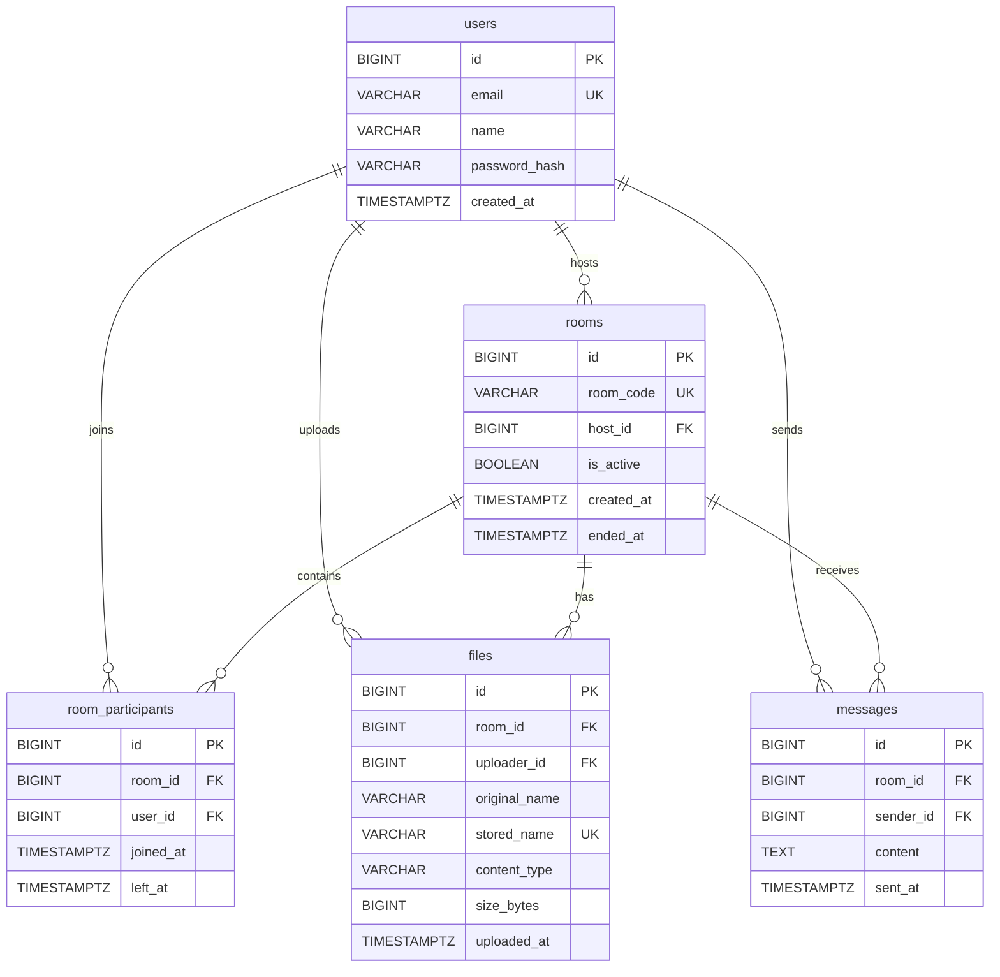

# MeetApp — Database Design Document (DATABASE.md)

## 1. Overview
MeetApp persists core relational data in PostgreSQL while keeping transient states in memory and raw binaries on disk:
- **PostgreSQL:** Users, rooms, participants, file meta, chat.
- **In-Memory:** Session registry (`RoomSessionRegistry`) & canvas stroke buffer (`WhiteboardService`).
- **Local Disk:** File binaries in `/uploads` behind `StorageService`.

---

## 2. Entity-Relationship Diagram


---

## 3. Table Definitions
All tables use `BIGINT GENERATED ALWAYS AS IDENTITY` for efficient 64-bit PKs and compact indexing.

### 3.1 `users` Table (FR-1, FR-2)
| Column | Type | Nullable | Default | Constraints | Notes |
| :--- | :--- | :--- | :--- | :--- | :--- |
| `id` | `BIGINT` | No | `IDENTITY` | `PK` | User ID |
| `name` | `VARCHAR(100)` | No | None | `CHECK (length(name) >= 2)` | Display name |
| `email` | `VARCHAR(255)` | No | None | `UNIQUE, CHECK (email = lower(email))` | Lowercase email |
| `password_hash`| `VARCHAR(255)` | No | None | None | BCrypt hash |
| `created_at` | `TIMESTAMPTZ` | No | `NOW()` | None | Creation time |

### 3.2 `rooms` Table (FR-4, FR-5, FR-6)
| Column | Type | Nullable | Default | Constraints | Notes |
| :--- | :--- | :--- | :--- | :--- | :--- |
| `id` | `BIGINT` | No | `IDENTITY` | `PK` | Room ID |
| `room_code` | `VARCHAR(32)` | No | None | `UNIQUE, CHECK (length(room_code) >= 6)` | Room code |
| `host_id` | `BIGINT` | No | None | `FK -> users(id)` | Room host |
| `is_active` | `BOOLEAN` | No | `TRUE` | None | Open flag |
| `created_at` | `TIMESTAMPTZ` | No | `NOW()` | None | Start time |
| `ended_at` | `TIMESTAMPTZ` | Yes | `NULL` | None | Close time |

### 3.3 `room_participants` Table (FR-5, FR-7)
| Column | Type | Nullable | Default | Constraints | Notes |
| :--- | :--- | :--- | :--- | :--- | :--- |
| `id` | `BIGINT` | No | `IDENTITY` | `PK` | Record ID |
| `room_id` | `BIGINT` | No | None | `FK -> rooms(id)` | Room reference |
| `user_id` | `BIGINT` | No | None | `FK -> users(id)` | User reference |
| `joined_at` | `TIMESTAMPTZ` | No | `NOW()` | None | Join time |
| `left_at` | `TIMESTAMPTZ` | Yes | `NULL` | None | Exit time (`NULL`=active) |

### 3.4 `files` Table (FR-15, FR-16, FR-17)
| Column | Type | Nullable | Default | Constraints | Notes |
| :--- | :--- | :--- | :--- | :--- | :--- |
| `id` | `BIGINT` | No | `IDENTITY` | `PK` | File ID |
| `room_id` | `BIGINT` | No | None | `FK -> rooms(id)` | Target room |
| `uploader_id` | `BIGINT` | No | None | `FK -> users(id)` | Uploader ID |
| `original_name`| `VARCHAR(255)` | No | None | None | Sanitized name |
| `stored_name` | `VARCHAR(255)` | No | None | `UNIQUE` | UUID disk name |
| `content_type` | `VARCHAR(100)` | No | None | None | MIME type |
| `size_bytes` | `BIGINT` | No | None | `CHECK (size_bytes > 0 AND size_bytes <= 10485760)` | Max 10 MB |
| `uploaded_at` | `TIMESTAMPTZ` | No | `NOW()` | None | Upload time |

### 3.5 `messages` Table (FR-22)
| Column | Type | Nullable | Default | Constraints | Notes |
| :--- | :--- | :--- | :--- | :--- | :--- |
| `id` | `BIGINT` | No | `IDENTITY` | `PK` | Message ID |
| `room_id` | `BIGINT` | No | None | `FK -> rooms(id)` | Room ID |
| `sender_id` | `BIGINT` | No | None | `FK -> users(id)` | Sender ID |
| `content` | `TEXT` | No | None | `CHECK (length(trim(content)) > 0)` | Chat text |
| `sent_at` | `TIMESTAMPTZ` | No | `NOW()` | None | Sent time |

---

## 4. Constraints & Integrity Rules
- **Foreign Keys:** `rooms.host_id -> users(id)` (`RESTRICT`); others use `CASCADE` on `rooms`/`users`.
- **Integrity:** `email` lowercase & unique; `size_bytes` $\le 10$MB; `content` non-empty.

---

## 5. Indexes
| Index Name | Table | Columns | Purpose |
| :--- | :--- | :--- | :--- |
| `idx_users_email` | `users` | `email` | User lookup during login |
| `idx_rooms_code` | `rooms` | `room_code` | Room lookup by code |
| `idx_participants_active`| `room_participants` | `room_id, user_id` WHERE `left_at IS NULL` | Active 5-user capacity check |
| `idx_files_room` | `files` | `room_id` | List files for room |
| `idx_messages_room_sent` | `messages` | `room_id, sent_at DESC` | Ordered chat history |

---

## 6. Flyway Migration Plan

| File | Purpose |
| :--- | :--- |
| `V1__create_users.sql` | Create `users` table |
| `V2__create_rooms.sql` | Create `rooms` table |
| `V3__create_room_participants.sql` | Create `room_participants` table |
| `V4__create_files.sql` | Create `files` table |
| `V5__create_messages.sql` | Create `messages` table |
| `V6__create_indexes.sql` | Create indexes |

```sql
-- V1__create_users.sql
CREATE TABLE users (
    id BIGINT GENERATED ALWAYS AS IDENTITY PRIMARY KEY,
    name VARCHAR(100) NOT NULL CHECK (length(name) >= 2),
    email VARCHAR(255) NOT NULL UNIQUE CHECK (email = lower(email)),
    password_hash VARCHAR(255) NOT NULL, created_at TIMESTAMPTZ NOT NULL DEFAULT NOW()
);

-- V2__create_rooms.sql
CREATE TABLE rooms (
    id BIGINT GENERATED ALWAYS AS IDENTITY PRIMARY KEY,
    room_code VARCHAR(32) NOT NULL UNIQUE CHECK (length(room_code) >= 6),
    host_id BIGINT NOT NULL REFERENCES users(id) ON DELETE RESTRICT,
    is_active BOOLEAN NOT NULL DEFAULT TRUE,
    created_at TIMESTAMPTZ NOT NULL DEFAULT NOW(), ended_at TIMESTAMPTZ
);

-- V3__create_room_participants.sql
CREATE TABLE room_participants (
    id BIGINT GENERATED ALWAYS AS IDENTITY PRIMARY KEY,
    room_id BIGINT NOT NULL REFERENCES rooms(id) ON DELETE CASCADE,
    user_id BIGINT NOT NULL REFERENCES users(id) ON DELETE CASCADE,
    joined_at TIMESTAMPTZ NOT NULL DEFAULT NOW(), left_at TIMESTAMPTZ
);

-- V4__create_files.sql
CREATE TABLE files (
    id BIGINT GENERATED ALWAYS AS IDENTITY PRIMARY KEY,
    room_id BIGINT NOT NULL REFERENCES rooms(id) ON DELETE CASCADE,
    uploader_id BIGINT NOT NULL REFERENCES users(id) ON DELETE CASCADE,
    original_name VARCHAR(255) NOT NULL, stored_name VARCHAR(255) NOT NULL UNIQUE,
    content_type VARCHAR(100) NOT NULL,
    size_bytes BIGINT NOT NULL CHECK (size_bytes > 0 AND size_bytes <= 10485760),
    uploaded_at TIMESTAMPTZ NOT NULL DEFAULT NOW()
);

-- V5__create_messages.sql
CREATE TABLE messages (
    id BIGINT GENERATED ALWAYS AS IDENTITY PRIMARY KEY,
    room_id BIGINT NOT NULL REFERENCES rooms(id) ON DELETE CASCADE,
    sender_id BIGINT NOT NULL REFERENCES users(id) ON DELETE CASCADE,
    content TEXT NOT NULL CHECK (length(trim(content)) > 0),
    sent_at TIMESTAMPTZ NOT NULL DEFAULT NOW()
);

-- V6__create_indexes.sql
CREATE INDEX idx_users_email ON users(email);
CREATE INDEX idx_rooms_code ON rooms(room_code);
CREATE INDEX idx_participants_active ON room_participants(room_id, user_id) WHERE left_at IS NULL;
CREATE INDEX idx_files_room ON files(room_id);
CREATE INDEX idx_messages_room_sent ON messages(room_id, sent_at DESC);
```

---

## 7. JPA Mapping Notes
- Entities: `User` $\to$ `users`, `Room` $\to$ `rooms`, `RoomParticipant` $\to$ `room_participants`, `FileMeta` $\to$ `files`, `ChatMessage` $\to$ `messages`.
- Associations (`@ManyToOne`) use `FetchType.LAZY`. DTOs used exclusively. Hibernate `ddl-auto=validate`.

---

## 8. Key Application Queries
```sql
-- 1. Find user by email
SELECT id, name, email, password_hash, created_at FROM users WHERE email = :email;
-- 2. Create room
INSERT INTO rooms (room_code, host_id, is_active, created_at) VALUES (:roomCode, :hostId, TRUE, NOW()) RETURNING id;
-- 3. Count active participants (5-user limit)
SELECT COUNT(*) FROM room_participants WHERE room_id = :roomId AND left_at IS NULL;
-- 4. Mark participant left
UPDATE room_participants SET left_at = NOW() WHERE room_id = :roomId AND user_id = :userId AND left_at IS NULL;
-- 5. End room
UPDATE rooms SET is_active = FALSE, ended_at = NOW() WHERE room_code = :roomCode;
-- 6. List files for room
SELECT id, original_name, stored_name, content_type, size_bytes, uploaded_at FROM files WHERE room_id = :roomId ORDER BY uploaded_at ASC;
-- 7. Load recent chat messages
SELECT m.id, m.content, m.sent_at, u.name AS sender_name FROM messages m JOIN users u ON m.sender_id = u.id WHERE m.room_id = :roomId ORDER BY m.sent_at ASC LIMIT 50;
```

---

## 9. Data Lifecycle & Retention
- **Active Call:** Real-time DB writes for participants, chat, and files.
- **Room End:** Sets `rooms.is_active=FALSE`, `ended_at=NOW()`, updates `left_at=NOW()` for participants.
- **Disk File Deletion:** Deleting a file row triggers `LocalStorageService.deleteFile(stored_name)` on disk.
- **Cleanup:** Inactive rooms older than 7 days can be pruned via scheduled job.

---

## 10. Security, Privacy & InsForge RLS
- **Hygiene:** Passwords stored with BCrypt; no plain secrets logged. Email is only stored PII.
- **Connection:** Mandates `sslmode=require` via non-superuser database account.
- **InsForge Auto-API Defense (RLS):**
```sql
ALTER TABLE users ENABLE ROW LEVEL SECURITY;
ALTER TABLE rooms ENABLE ROW LEVEL SECURITY;
ALTER TABLE room_participants ENABLE ROW LEVEL SECURITY;
ALTER TABLE files ENABLE ROW LEVEL SECURITY;
ALTER TABLE messages ENABLE ROW LEVEL SECURITY;
```

---

## 11. Local Development
- `docker-compose.yml` provides Postgres 15 on port 5432.
- Flyway auto-migrates on startup. Reset with `docker compose down -v`.

---

## 12. Backup & Recovery
- Logical dump: `pg_dump -h $DB_HOST -U $DB_USER -d $DB_NAME --no-owner --clean > backup.sql`.

---

## 13. Troubleshooting
- **Connection Refused:** Verify DB container / host wake state.
- **SSL Error:** Ensure `sslmode=require` in JDBC URL.
- **Flyway Checksum Mismatch:** Repair with `mvn flyway:repair`.
- **Schema Validation Errors:** Align JPA field types with Flyway DDL.

---

## 14. Open Questions
- *File Retention:* Purge files immediately on room end or keep for a grace period?
- *Chat Retention:* Retain chat indefinitely or cap at 30 days?
