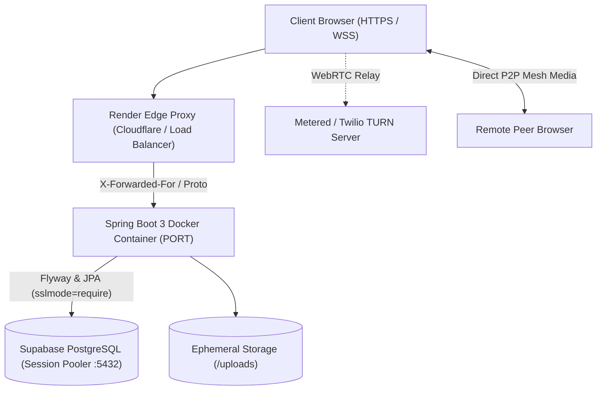

# MeetApp — Deployment Guide (DEPLOYMENT.md)

## 1. Overview & Production Architecture
MeetApp is packaged as a lightweight, production-hardened Docker container deployed to **Render** as a single, unified Web Service. The service serves both the Spring Boot 3 backend (REST API, WebSocket signaling, and static assets) and the plain HTML5/CSS/JavaScript frontend from the same origin. The backend connects to an external managed **Supabase PostgreSQL** database over an SSL-encrypted connection, with external STUN/TURN servers facilitating WebRTC media traversal across restrictive client firewalls.



---

## 2. Production Design & Architecture Decisions

### 2.1 Unified Single-Origin Service (Recommended)
- **Architecture:** A single Render Web Service serves the Spring Boot REST API, WebSocket signaling (`/ws`), and static frontend assets (`src/main/resources/static/`).
- **Advantages:**
  - **Zero Cross-Origin Friction:** API calls (`/api/...`) and WebSocket upgrades (`/ws`) are strictly same-origin. Preflight `OPTIONS` overhead is eliminated.
  - **Eliminates WebSocket Origin Mismatches:** Handshake origin checking matches the server's own host without brittle cross-domain configuration.
  - **Single Artifact & Single Deployment:** Frontend and backend code are built and versioned together in a single Docker image, guaranteeing zero contract skew.
  - **Resource Efficiency:** Free-tier usage is consolidated within a single service, consuming only one instance-hour pool (750 hours/month) instead of two.

### 2.2 Production Database: Supabase PostgreSQL
- **Environment Isolation:** A dedicated production Supabase project completely separate from development/testing databases.
- **Connection Method:** Connect via Supabase's **Session Pooler** (IPv4-compatible pooler host on port **5432**) with `?sslmode=require`. Session pooling is required because Flyway schema migrations and JPA schema validation require prepared statements and session-level locks (`pg_locks`), which fail or behave unpredictably under transaction pooling (`pgbouncer` in transaction mode on port 6543).
- **Least-Privilege User:** Use a dedicated database user (or schema-restricted role) for application runtime where practical.
- **Automated Migrations:** Flyway runs automatically on startup in production, validating and applying migrations (`V1` to `V11`) safely before the application accepts traffic.

### 2.3 Region Selection: Singapore (`singapore`)
- **Developer / Primary Target Location:** India.
- **Render Available Regions:** Oregon (US), Ohio (US), Virginia (US), Frankfurt (Germany), Singapore (Southeast Asia).
- **Recommendation:** **Singapore (`singapore`)**.
- **Latency & Signaling Impact:**
  - Round-trip time (RTT) from India to Singapore is **30–50 ms**, compared to **120–160 ms** to Frankfurt and **180–250 ms** to US regions.
  - While WebRTC audio/video media flows peer-to-peer (or via TURN) after connection establishment, all room discovery, ticket issuance, SDP offer/answer exchanges, and ICE candidate trickling flow through the signaling server over WebSocket.
  - Low signaling latency ensures call setup, track renegotiation (e.g. starting a screen share), chat delivery, and whiteboard drawing synchronization feel instantaneous without perceptible lag.

### 2.4 Render Free Plan Specifications & Operational Behavior
Render's official Free Web Service limits and their direct effects on MeetApp:

| Metric / Feature | Render Free Tier Specification | Impact on MeetApp & Mitigation |
| :--- | :--- | :--- |
| **RAM / CPU** | **512 MB RAM**, shared CPU (~0.1 CPU core). | JVM memory must be tightly constrained. Configured `-XX:MaxRAMPercentage=75.0` (~384 MB heap) leaving ~128 MB for Metaspace, threads, and OS buffers to prevent Linux OOM killer (exit code 137). |
| **Inactivity Spindown** | Service spins down (sleeps) after **15 minutes** of no incoming HTTP traffic or WebSocket activity. | The first user request after sleep triggers a cold start (**50–60 seconds**) while the container starts up. Pre-warming via `/actuator/health` is advised prior to live demos. |
| **Monthly Uptime Hours**| **750 free instance hours** per month per workspace. | Running a single free service consumes at most 744 hours in a 31-day month, fitting within the free allocation. |
| **Build Minutes** | **500 build minutes** per month. | Multi-stage Docker build caches Maven dependencies, keeping subsequent builds fast (typically 1–2 minutes). |
| **Volatile Storage** | Local container filesystem (`/uploads`) is **ephemeral**. | Any service restart, sleep spindown, or new deploy wipes locally stored uploads. Metadata remains in the database, but binary files are temporary. Documented in user README. |
| **In-Memory Signaling** | In-memory room registries, active whiteboard strokes, and WebSocket tickets reside in RAM. | A service restart or redeploy resets active room signaling and in-progress whiteboard canvases. Users must re-create/re-join rooms upon container recovery. |

---

## 3. Environment Variables Reference

All production configuration is supplied securely via Render environment variables. Secrets are entered directly in the Render Dashboard (or marked `sync: false` in Blueprints) and are **never** committed to version control.

| Variable | Purpose | Secret? | Required | Production Value / Example Placeholder |
| :--- | :--- | :---: | :---: | :--- |
| `PORT` | HTTP port provided by Render's runtime | No | Auto | Provided automatically by Render (defaults to `10000`) |
| `SPRING_PROFILES_ACTIVE` | Activates production Spring configuration | No | Yes | `prod` |
| `DB_URL` | PostgreSQL JDBC connection URL | No | Yes | `jdbc:postgresql://aws-0-ap-southeast-1.pooler.supabase.com:5432/postgres?sslmode=require` |
| `DB_USER` | Database username | No | Yes | `postgres.yourprojectref` |
| `DB_PASSWORD` | Database password | **Yes** | Yes | `[PLACEHOLDER: DB_PASSWORD]` |
| `JWT_SECRET` | 256-bit signing key for authentication tokens | **Yes** | Yes | `[PLACEHOLDER: JWT_SECRET_256_BITS_MIN_32_CHARS]` |
| `OTP_PEPPER` | 256-bit pepper for hashing login OTPs at rest | **Yes** | Yes | `[PLACEHOLDER: OTP_PEPPER_SECRET_32_CHARS]` |
| `AES_KEY` | Base64-encoded 256-bit key for AES-GCM encryption | **Yes** | Yes | `[PLACEHOLDER: BASE64_AES_KEY_32_BYTES]` |
| `APP_ALLOWED_ORIGIN` | Public HTTPS domain assigned by Render | No | Yes | `https://meetapp-xyz.onrender.com` |
| `EMAIL_PROVIDER` | Email delivery provider (`resend` in production) | No | Yes | `resend` |
| `RESEND_API_KEY` | API key for Resend transactional email API | **Yes** | Yes | `[PLACEHOLDER: re_dummy_resend_api_key]` |
| `MAIL_FROM` | Verified sender email address for OTPs | No | Yes | `onboarding@resend.dev` (or verified custom domain) |
| `UPLOAD_DIR` | Directory path for ephemeral file storage | No | No | `uploads` |
| `MAX_FILE_SIZE_MB` | Maximum allowed individual upload size | No | No | `10` |
| `MAX_ROOM_STORAGE_MB`| Maximum cumulative upload quota per room | No | No | `50` |
| `MAX_ROOM_FILES` | Maximum total files per room | No | No | `20` |
| `MAX_ROOM_PARTICIPANTS`| Maximum concurrent participants per room | No | No | `5` |
| `STUN_URLS` | Comma-separated STUN server addresses | No | No | `stun:stun.l.google.com:19302` |
| `TURN_URL` | Comma-separated TURN server addresses | No | No | `turn:relay.metered.ca:443?transport=tcp` |
| `TURN_USERNAME` | TURN relay username | No | No | `meetapp-turn-user` |
| `TURN_CREDENTIAL` | TURN relay authentication credential | **Yes** | No | `[PLACEHOLDER: TURN_CREDENTIAL]` |

---

## 4. Reverse Proxy & Forwarded Headers Configuration

### 4.1 Threat Model & Reverse Proxy Mechanics
Render routes external client traffic through Cloudflare and internal load balancers before terminating at the container:
1. The TCP socket connection arriving at the Spring Boot application originates from Render's internal proxy IP.
2. Render forwards client identity via standard HTTP request headers:
   - `X-Forwarded-For`: Contains client IP followed by intermediate proxy IPs (`<client-ip>, <proxy-1>`).
   - `X-Forwarded-Proto`: Set to `https`.
   - `X-Forwarded-Port`: Set to `443`.
3. **Risks if Unconfigured:**
   - *Rate-Limiting Denial of Service:* Without forwarded header processing, `request.getRemoteAddr()` returns the internal proxy IP. All users globally share the same IP, meaning 5 failed logins by one user would lock out all users globally.
   - *IP Spoofing Risk:* Blindly reading unverified headers allows malicious clients to spoof client IP and bypass rate limits.

### 4.2 Safe Spring Boot Strategy
Configure Spring Boot's native header strategy:
```yaml
server:
  forwarded-header-strategy: framework
```
- Setting `server.forwarded-header-strategy: framework` registers Spring's `ForwardedHeaderFilter`.
- The filter extracts the leftmost client IP from `X-Forwarded-For` and updates `HttpServletRequest.getRemoteAddr()`, `getScheme()`, and `getServerPort()`.
- Rate limiters and security audits consistently read the genuine client IP without custom parsing code.

---

## 5. Health Check & Build Configuration

- **Health Check Path:** `/actuator/health`
- **Expected Status:** HTTP `200 OK` with JSON `{"status":"UP"}`.
- **Probe Design:** Fast, non-blocking health check. Database liveness is validated during startup via Flyway; `/actuator/health` acts as a responsive liveness probe that prevents premature container termination during temporary database latency spikes.
- **Container Build Command:**
  - Automated via multi-stage `Dockerfile`.
- **Container Runtime Command:**
  ```bash
  java -XX:MaxRAMPercentage=75.0 -Djava.security.egd=file:/dev/./urandom -jar app.jar
  ```
- **Port Binding:** Reads dynamic `$PORT` environment variable injected by Render, defaulting to `8080` locally and `10000` on Render.

---

## 6. Blueprint Configuration (`render.yaml`)
Render Blueprints support Docker-based web services with non-sensitive variables declared in code and sensitive credentials guarded via `sync: false`:

```yaml
services:
  - type: web
    name: meetapp
    runtime: docker
    plan: free
    region: singapore
    healthCheckPath: /actuator/health
    envVars:
      - key: SPRING_PROFILES_ACTIVE
        value: prod
      - key: DB_URL
        sync: false
      - key: DB_USER
        sync: false
      - key: DB_PASSWORD
        sync: false
      - key: JWT_SECRET
        sync: false
      - key: OTP_PEPPER
        sync: false
      - key: AES_KEY
        sync: false
      - key: APP_ALLOWED_ORIGIN
        sync: false
      - key: EMAIL_PROVIDER
        value: resend
      - key: RESEND_API_KEY
        sync: false
      - key: MAIL_FROM
        value: onboarding@resend.dev
      - key: STUN_URLS
        value: stun:stun.l.google.com:19302
      - key: TURN_URL
        sync: false
      - key: TURN_USERNAME
        sync: false
      - key: TURN_CREDENTIAL
        sync: false
```
