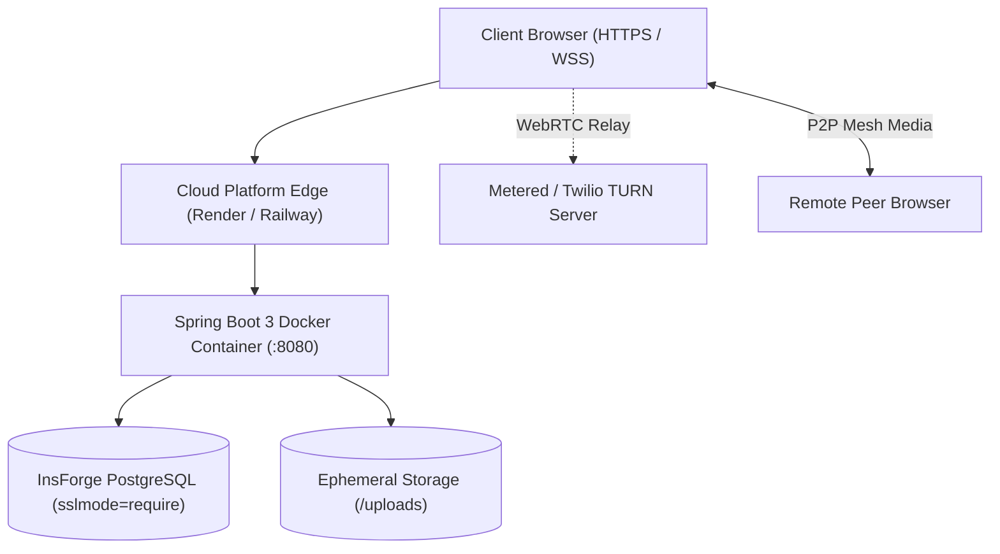

# MeetApp — Deployment Guide (DEPLOYMENT.md)

## 1. Overview & Production Architecture
MeetApp is packaged as a lightweight Docker container and deployed to cloud PaaS providers (Render or Railway). The application connects to a managed PostgreSQL database hosted on InsForge over an encrypted SSL connection, with external STUN/TURN servers facilitating WebRTC media traversal across restrictive client firewalls.



---

## 2. Pre-Deployment Checklist
- [ ] All unit and integration tests pass cleanly (`mvn clean test`).
- [ ] Repository is clean with no hardcoded credentials or `.env` files committed.
- [ ] Production profile (`application-prod.yml`) references environment variables.
- [ ] Flyway migration scripts (`V1` to `V6`) validated against a clean PostgreSQL instance.
- [ ] Free-tier TURN server credentials obtained and verified.

---

## 3. Environment Variables
All production configuration is supplied via platform environment variables:

| Variable | Purpose | Example Placeholder | Required | Secret? |
| :--- | :--- | :--- | :---: | :---: |
| `DB_URL` | PostgreSQL JDBC connection string | `jdbc:postgresql://db.insforge.com:5432/meetapp?sslmode=require` | Yes | No |
| `DB_USER` | Database username | `meetapp_user` | Yes | No |
| `DB_PASSWORD` | Database password | `[PLACEHOLDER: DB_PASSWORD]` | Yes | Yes |
| `JWT_SECRET` | 256-bit key for signing tokens | `[PLACEHOLDER: JWT_SECRET_256_BITS]` | Yes | Yes |
| `APP_ALLOWED_ORIGIN` | Authorized client domain for CORS | `https://meetapp.onrender.com` | Yes | No |
| `UPLOAD_DIR` | Directory for shared files | `/uploads` | Yes | No |
| `STUN_URLS` | STUN server URLs | `stun:stun.l.google.com:19302` | Yes | No |
| `TURN_URL` | TURN relay server URL | `turn:relay.metered.ca:443` | No | No |
| `TURN_USERNAME` | TURN authentication username | `meetapp-turn-user` | No | No |
| `TURN_CREDENTIAL` | TURN authentication credential | `[PLACEHOLDER: TURN_CREDENTIAL]` | No | Yes |

---

## 4. Docker Container Packaging
The project uses a multi-stage `Dockerfile`:
1. **Builder Stage:** Compiles the application using Maven and Eclipse Temurin 17 JDK.
2. **Runtime Stage:** Copies the fat JAR into an Alpine Linux JRE image, executes under a non-root user, exposes port 8080, and checks health via `/actuator/health`.

### Local Build & Test Commands
```bash
docker build -t meetapp:latest .
docker run -p 8080:8080 --env-file .env meetapp:latest
```

---

## 5. Step-by-Step Deployment: Render
1. Sign in to [Render](https://render.com) and click **New + > Web Service**.
2. Connect your GitHub repository: `https://github.com/Mohitkumar7295/Real-Time-Communication-App`.
3. Configure service:
   - **Environment:** `Docker`
   - **Region:** Nearest to your target users (e.g., Oregon or Frankfurt).
   - **Instance Type:** `Free`.
4. Under **Advanced > Environment Variables**, add each variable from Section 3.
5. Set **Health Check Path** to `/actuator/health`.
6. Click **Create Web Service**. Render builds the image and deploys.

---

## 6. Step-by-Step Deployment: Railway (Alternative)
1. Sign in to [Railway](https://railway.app) and select **New Project > Deploy from GitHub repo**.
2. Select the MeetApp repository.
3. In the service settings, navigate to **Variables** and add the required environment variables.
4. Set **Healthcheck Path** to `/actuator/health`.
5. Railway automatically detects the `Dockerfile`, triggers the build, and generates a public HTTPS URL.

---

## 7. Database Setup on InsForge
1. Create a PostgreSQL database on InsForge.
2. Obtain the connection parameters and construct the JDBC string:  
   `jdbc:postgresql://<HOST>:<PORT>/<DATABASE>?sslmode=require`
3. Flyway executes automatically on initial container startup, creating all 5 tables and indexes.
4. Verify database isolation: Confirm Row-Level Security (RLS) is active to prevent exposure through InsForge's auto REST API:
   ```sql
   SELECT tablename, rowsecurity FROM pg_tables WHERE schemaname = 'public';
   ```
5. *Fallback:* If direct JDBC access is restricted on specific InsForge plans, repoint `DB_URL` to any cloud PostgreSQL provider (e.g., Supabase, Neon, or Railway Postgres) without application changes.

---

## 8. TURN Server Setup
Direct WebRTC P2P fails when both users are behind symmetric NATs or corporate firewalls.
1. Obtain free TURN relay credentials from providers like [Metered.ca](https://www.metered.ca/) or Twilio.
2. Set `TURN_URL`, `TURN_USERNAME`, and `TURN_CREDENTIAL` in the cloud host dashboard.
3. Test traversal by joining the room from two separate physical networks (e.g., home Wi-Fi and mobile 4G).

---

## 9. HTTPS, WSS & Proxy Settings
- Render and Railway provide managed TLS certificates automatically.
- WebSocket handshakes upgrade seamlessly over `wss://<DOMAIN>/ws?token=<JWT>&room=<code>`.
- *Proxy Keep-Alive:* Cloud edge proxies terminate idle WebSockets after 60–100 seconds of silence. MeetApp's `socket.js` client emits periodic heartbeat pings every 30 seconds to maintain persistent connections.

---

## 10. File Storage & Cloud Limitations
- On free-tier container instances, files uploaded to `/uploads` reside on ephemeral disk storage and are lost during container restarts or redeployments.
- For permanent production workloads, implement `StorageService` using Amazon S3 or Cloudflare R2.
- *Notice:* Inform demo reviewers that room file attachments are temporary.

---

## 11. Free-Tier Sleeping & Pre-Warming
- Free instances sleep after 15 minutes of inactivity.
- The first request incurs a 45–60 second cold start delay while the container spins up.
- *Pre-Warm:* Before conducting a live demo or evaluation, access `https://<APP_URL>/actuator/health` to wake the service.

---

## 12. Post-Deployment Smoke Test
1. Access `https://<APP_URL>` over HTTPS; verify landing page renders.
2. Register a new user and confirm redirect to login.
3. Log in, verify JWT storage, and create a meeting from the dashboard.
4. Open a second device on mobile 4G, join with the room code, and confirm bidirectional video.
5. Initiate screen share from desktop; verify mobile receives display feed.
6. Upload a 1 MB PDF and download from the second device.
7. Draw on whiteboard; verify synchronized strokes.

---

## 13. Rollback & Redeploy
- **Redeploy:** Trigger manual redeploy from Render/Railway dashboard.
- **Rollback:** In the deployments list, select the previous successful build and click **Rollback**.

---

## 14. Monitoring & Troubleshooting
View container logs in the cloud dashboard under the **Logs** tab.

| Symptom | Likely Cause | Fix |
| :--- | :--- | :--- |
| **502 Bad Gateway** | Container failed to start / port mismatch | Verify container listens on port 8080 and `/actuator/health` is UP. |
| **Connection Refused (DB)** | Database host sleeping or bad URL | Verify host address and credentials in `DB_URL`. |
| **SSL Handshake Error** | Missing SSL parameter | Ensure `?sslmode=require` is appended to `DB_URL`. |
| **WebSocket 1008 Close** | Invalid JWT or room full | Check client token validity and participant limits. |
| **Video Fails Cross-Network**| Symmetric NAT blocking direct P2P | Configure valid TURN credentials in platform environment. |
| **CORS Block** | Mismatched allowed origin | Set `APP_ALLOWED_ORIGIN` to exact public HTTPS domain. |
| **Camera Blocked** | Insecure context (HTTP) | Ensure site is accessed exclusively over `https://`. |

---

## 15. Production Security Checklist
- [ ] Secrets injected via dashboard environment variables (never committed to Git).
- [ ] Actuator restricted strictly to `/actuator/health`.
- [ ] Detailed stack traces suppressed in error responses.
- [ ] CORS restricted strictly to public frontend origin.
- [ ] Strong random 256-bit JWT secret configured.
